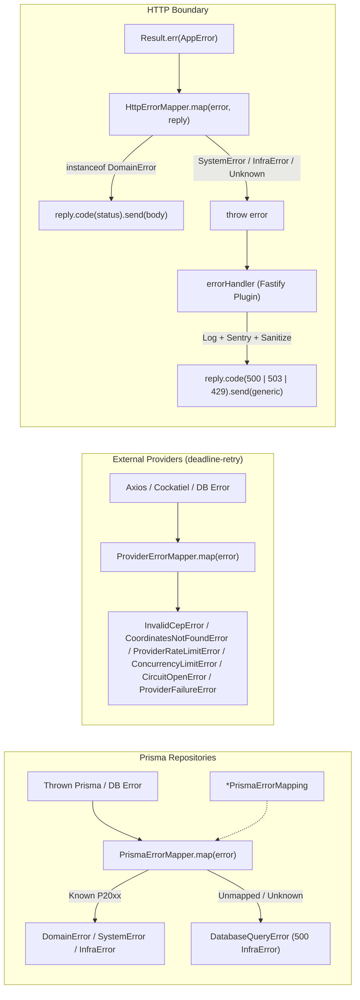

# Error Classes & Mappers — Phased Refactor Plan

Standardizes error class naming, error hierarchy inheritance (`DomainError` vs. `SystemError` vs. `InfrastructureError`), error mapper contracts (`IErrorMapper.map`, `PrismaErrorMapper.map`, `ProviderErrorMapper.map`, `HttpErrorMapper.map`), Prisma error-mapping configurations (`<domain>PrismaErrorMapping`), and error mapper variable names (`<domain>ErrorMapper`) across `src/`.

Scope: **error class names (including disambiguating `ServiceBusyError` vs. `ServiceOverloadError`), error inheritance hierarchy, mapper interfaces and method names, Prisma error-mapping table names, factory/worker mapper variable names, `ProviderErrorMapper` relocation into `src/infra/providers/helpers/`, and provider `errors/` directory pluralization.** The `Result<T, E>` pattern, PT-BR error message catalogs (`src/common/messages/errors/*`), error codes (`body.code`), `FailureMode`, and `TelemetryReason` semantics remain unchanged.

> **Status:** Completed (Phases 0–6 executed, quality gates and verification gauntlet 100% passing).

---

## 1. Architectural Decisions Record (ADR)

Every naming ambiguity and hierarchy classification was resolved upfront and governs all phases below:

| # | Decision Area | Chosen Convention | Rationale |
| - | ------------- | ----------------- | --------- |
| **D1** | **Error mapper method contract (`IErrorMapper` & `PrismaErrorMapper`)** | Rename `IErrorMapper.mapToKnownError(error: unknown): unknown` and `PrismaErrorMapper.mapToKnownError(error: unknown): AppError` to **`map(error: unknown)`**. Keep `HttpErrorMapper.map(error, reply)` and `ProviderErrorMapper.map(error)`. | `PrismaErrorMapper` maps unconfigured or non-Prisma errors to `new DatabaseQueryError(error)` (a generic 500 `InfrastructureError`), so `mapToKnownError` was misleading. Standardizing on `.map(...)` aligns `IErrorMapper`, `PrismaErrorMapper`, `ProviderErrorMapper`, and `HttpErrorMapper`. |
| **D2** | **Prisma error-mapping config files & constants** | Standardize mapping config files to `<domain>-prisma-error-mapping.ts` and exported constants to **`<domain>PrismaErrorMapping`** (`usersPrismaErrorMapping`, `churchesPrismaErrorMapping`, `formsPrismaErrorMapping`, `outboxDomainPrismaErrorMapping`, `outboxInfraPrismaErrorMapping`). | Distinguishes the declarative **mapping table** (`*PrismaErrorMapping: PrismaErrorMappingConfig<AppError>`) from the instantiated **mapper object** (`*ErrorMapper: PrismaErrorMapper<AppError>`), and standardizes pluralization across modules (`users`, `churches`, `forms`, `outbox`). |
| **D3** | **Error mapper instance & property naming** | Standardize `PrismaErrorMapper` instances across factories, repositories, `src/worker.ts`, and specs to **`<domain>ErrorMapper`** (`usersErrorMapper`, `churchesErrorMapper`, `formsErrorMapper`, `outboxDomainErrorMapper`, `outboxInfraErrorMapper`). | Eliminates ambiguous shorthands such as `outboxHttpMapper`, `outboxInfraMapper`, `userErrorMapper`, and generic `errorMapper` in multi-repository factories. |
| **D4** | **Outbox error classes & repository mapper properties** | Rename `OutboxEventNotFoundHttpError` → **`OutboxEventNotFoundDomainError`** and `OutboxOperationFailedHttpError` → **`OutboxOperationFailedSystemError`**; keep **`OutboxEventNotFoundInfraError`** and **`OutboxOperationFailedInfraError`**. Rename `PrismaOutboxRepository` constructor properties from `httpErrorMapper` / `infraErrorMapper` to **`domainErrorMapper`** / **`infraErrorMapper`**. | `PrismaOutboxRepository` does not belong to the HTTP transport layer. Its `create()` method runs inside synchronous application/domain transactions (where failures surface as `DomainError` or `SystemError`), whereas background worker methods (`findPending`, `claim`, `updateStatus`, `delete*`) surface `InfrastructureError`. |
| **D5** | **Forms error singularization & deduplication** | Rename `FormsAlreadyExistsError` → **`FormAlreadyExistsError`** (`form-already-exists-error.ts`), `FormsNotFoundError` → **`FormNotFoundError`** (`form-not-found-error.ts`), and consolidate the duplicate `FormSubmissionError` (500, unused in production) + `FormsSubmissionError` (400, used in `formsPrismaErrorMapping`) into a single **`FormSubmissionError`** (`form-submission-error.ts`, `ErrorType.BAD_REQUEST`). | Aligns `src/modules/forms/errors/` with singular entity error naming (`User*Error`, `Church*Error`, `VisitorNotFoundError`, `InvalidFormPayloadError`) and removes the dead duplicate class. |
| **D6** | **500-level `DomainError` reclassification (`CreateChurchError` & `UserNotCreatedError`)** | Reclassify `CreateChurchError` and `UserNotCreatedError` from `DomainError` to **`SystemError`**. | `HttpErrorMapper.map` sends any `DomainError` directly to the client and only rethrows non-`DomainError`s (`SystemError`, `InfrastructureError`, unknown) to the global `errorHandler` for structured logging, Sentry capture, and 500 response sanitization. A 500 `INTERNAL_SERVER_ERROR` when an insert returns no row is an internal invariant failure (`SystemError`), matching `CepToLatLonError` and `OutboxOperationFailedSystemError`. |
| **D7** | **`FindNearestChurchesErrorMapper` relocation & rename** | Rename `FindNearestChurchesErrorMapper` to **`ProviderErrorMapper`**, move it from `src/modules/churches/errors/mappings/find-nearest-churches-error-mapper.ts` to **`src/infra/providers/helpers/provider-error-mapper.ts`** (colocated with its `.spec.ts`), and remove the unused `runCatching` method. | Its sole production caller is `runWithRetries` in `src/infra/providers/helpers/deadline-retry.ts`, where it translates Axios, Cockatiel (`BrokenCircuitError`, `BulkheadRejectedError`), and Prisma errors for all external providers (ViaCEP, AwesomeAPI, BrasilAPI, Nominatim, LocationIQ, Stadia Maps, OpenRouteService). Relocating it removes the upward `@infra/providers` → `@modules/churches/errors/mappings` dependency. |
| **D8** | **Provider error directory pluralization** | Rename `src/infra/providers/{address-provider,church-routing-provider,geo-provider}/error/` (singular) to **`errors/`** (plural). | Matches the plural `errors/` folder convention used everywhere else in `src/common/`, `src/infra/`, and `src/modules/`. |
| **D9** | **Disambiguating `ServiceBusyError` vs. `ServiceOverloadError`** | Keep both classes **separate**, rename `ServiceBusyError` (`service-busy-error.ts`) → **`ProviderRateLimitError`** (`provider-rate-limit-error.ts`) and `ServiceOverloadError` (`service-overload-error.ts`) → **`ConcurrencyLimitError`** (`concurrency-limit-error.ts`), update `AppErrorRegistry` keys accordingly, and remove all leftover `as InfraServiceOverloadError` import aliases. | Although `ServiceBusyError` and `ServiceOverloadError` sounded synonymous, they represent distinct failure mechanisms with incompatible runtime contracts (see §2.2 below): per-provider HTTP 429 / rate-limiter rejection (`FailureMode.RETRYABLE`, `TelemetryReason.RATE_LIMITED`, `provider: string`) vs. local Cockatiel bulkhead concurrency rejection (`failureMode: undefined`, `telemetryReason: undefined`). |

---

## 2. Target Error Architecture & Directory Layout

### 2.1 Error Class Inheritance Hierarchy

```mermaid
classDiagram
  direction TB
  class AppError {
    <<abstract>>
    +ErrorType type
    +IErrorDetail body
    +FailureMode? failureMode
    +TelemetryReason? telemetryReason
  }
  class DomainError {
    <<abstract>>
  }
  class InfrastructureError {
    <<abstract>>
    +unknown originalError
  }
  class SystemError {
    <<abstract>>
  }

  AppError <|-- DomainError
  AppError <|-- InfrastructureError
  AppError <|-- SystemError
  AppError <|-- ZodValidationError

  DomainError <|-- FormAlreadyExistsError
  DomainError <|-- FormNotFoundError
  DomainError <|-- FormSubmissionError
  DomainError <|-- InvalidFormPayloadError
  DomainError <|-- OutboxEventNotFoundDomainError
  DomainError <|-- UserAlreadyExistsError
  DomainError <|-- UserNotFoundError
  DomainError <|-- ChurchAlreadyExistsError
  DomainError <|-- ChurchNotFoundError
  DomainError <|-- EmptyChurchListError
  DomainError <|-- NoNearbyChurchesFoundError
  DomainError <|-- InvalidCepError
  DomainError <|-- CoordinatesNotFoundError
  DomainError <|-- LatitudeRangeError
  DomainError <|-- LongitudeRangeError
  DomainError <|-- NoAddressError
  DomainError <|-- InvalidCredentialsError
  DomainError <|-- InvalidPasswordResetPayloadError
  DomainError <|-- InvalidTokenError
  DomainError <|-- VisitorNotFoundError

  SystemError <|-- CepToLatLonError
  SystemError <|-- CreateChurchError
  SystemError <|-- UserNotCreatedError
  SystemError <|-- OutboxOperationFailedSystemError
  SystemError <|-- AsyncLocalStorageNotInitializedError

  InfrastructureError <|-- DatabaseQueryError
  InfrastructureError <|-- OutboxEventNotFoundInfraError
  InfrastructureError <|-- OutboxOperationFailedInfraError
  InfrastructureError <|-- UnknownOutboxEventTypeError
  InfrastructureError <|-- ProviderFailureError
  InfrastructureError <|-- CircuitOpenError
  InfrastructureError <|-- ProviderRateLimitError
  InfrastructureError <|-- ConcurrencyLimitError
  InfrastructureError <|-- TimeoutExceededError
  InfrastructureError <|-- DeadlineExceededError
  InfrastructureError <|-- NoAddressProviderError
  InfrastructureError <|-- NoGeoProviderError
  InfrastructureError <|-- NoRoutingProviderError
  InfrastructureError <|-- JobAlreadyProcessingError
  InfrastructureError <|-- SmtpDispatchError
```



### 2.2 Why `ProviderRateLimitError` (`ServiceBusyError`) and `ConcurrencyLimitError` (`ServiceOverloadError`) Remain Separate

Merging the two classes would conflate per-provider rate limiting with local bulkhead concurrency shedding and break fallback routing:

| Dimension | `ProviderRateLimitError` *(formerly `ServiceBusyError`)* | `ConcurrencyLimitError` *(formerly `ServiceOverloadError`)* |
| --------- | -------------------------------------------------------- | ----------------------------------------------------------- |
| **Trigger** | External provider returns **HTTP 429** (`ProviderErrorMapper`) **or** outbound per-provider `RedisRateLimiter` (`checkAdmission`) refuses quota. | Cockatiel `BulkheadRejectedError` when `ResilientCache` exceeds `maxPendingFetches` (in-flight concurrency cap). |
| **Constructor** | `new ProviderRateLimitError(provider: string)` | `new ConcurrencyLimitError()` |
| **`FailureMode`** | `FailureMode.RETRYABLE` — instructs `Resilient*Provider` fallback chains to try the **next provider** because only this upstream is rate-limited. | `undefined` — **not retryable** by provider fallback chains because the local concurrency bulkhead is full. |
| **`TelemetryReason`** | `TelemetryReason.RATE_LIMITED` (increments `reason="rate_limited"` on provider metrics). | `undefined` (increments `collectMetricsCacheCircuitBreakerTrips` in cache metrics). |
| **`INFRA_ERRORS` Entry** | `INFRA_ERRORS.SERVICE_BUSY` (`code: 'SERVICE_BUSY'`) | `INFRA_ERRORS.SERVICE_OVERLOAD` (`code: 'SERVICE_OVERLOAD'`) |

### 2.3 Error Mapping Pipeline



### 2.4 Target Error & Mapper File Tree

```text
src/
├── common/
│   ├── errors/
│   │   ├── app-error.ts
│   │   ├── app-error-registry.ts
│   │   ├── app-error-registry.spec.ts
│   │   ├── domain-error.ts
│   │   ├── error-hierarchy.spec.ts
│   │   ├── infrastructure-error.ts
│   │   ├── prototype-chain-reached-through-error-lookup.regression.spec.ts
│   │   ├── provider-lost-in-error-round-trip.regression.spec.ts
│   │   ├── system-error.ts
│   │   └── infrastructure/
│   │       ├── circuit-open-error.ts
│   │       ├── circuit-open-error.spec.ts
│   │       ├── concurrency-limit-error.ts              # [RENAMED from service-overload-error.ts] ConcurrencyLimitError
│   │       ├── database-query-error.ts
│   │       ├── deadline-exceeded-error.ts
│   │       ├── provider-failure-error.ts
│   │       ├── provider-failure-error.spec.ts
│   │       ├── provider-rate-limit-error.ts            # [RENAMED from service-busy-error.ts] ProviderRateLimitError
│   │       └── timeout-exceeded-error.ts
│   ├── filters/
│   │   ├── aborted-request-floods-sentry.regression.spec.ts
│   │   ├── error-handler.filter.ts
│   │   ├── error-handler.filter.spec.ts
│   │   ├── http-error-mapper.ts
│   │   ├── http-error-mapper.spec.ts
│   │   ├── http-error-status.mapper.ts
│   │   ├── http-error-status.mapper.spec.ts
│   │   ├── zod-validation-error.ts
│   │   └── zod-validation-error.spec.ts
│   └── interfaces/
│       ├── app-error.interface.ts
│       ├── error-detail.interface.ts
│       └── error-mapper.interface.ts                   # IErrorMapper.map(error: unknown): unknown
│
├── infra/
│   ├── database/prisma/utils/
│   │   ├── prisma-error-mapper.ts                      # PrismaErrorMapper.map(error: unknown): AppError
│   │   └── prisma-error-mapper.spec.ts
│   ├── logger/errors/
│   │   └── async-local-storage-not-initialized-error.ts
│   ├── mail/errors/
│   │   ├── job-already-processing-error.ts
│   │   └── smtp-dispatch-error.ts
│   ├── outbox/
│   │   ├── errors/
│   │   │   ├── outbox-errors.ts                        # OutboxEventNotFoundDomainError, OutboxOperationFailedSystemError, *InfraError
│   │   │   └── unknown-outbox-event-type-error.ts
│   │   └── repositories/errors/
│   │       └── outbox-prisma-error-mapping.ts          # outboxDomainPrismaErrorMapping, outboxInfraPrismaErrorMapping
│   └── providers/
│       ├── helpers/
│       │   ├── provider-error-mapper.ts                # [MOVED & RENAMED] ProviderErrorMapper.map(error: unknown): AppError
│       │   └── provider-error-mapper.spec.ts
│       ├── address-provider/errors/                    # [RENAMED from error/]
│       │   └── no-address-provider-error.ts
│       ├── church-routing-provider/errors/             # [RENAMED from error/]
│       │   └── no-routing-provider-error.ts
│       └── geo-provider/errors/                        # [RENAMED from error/]
│           └── no-geo-provider-error.ts
│
└── modules/
    ├── analytics/errors/
    │   └── visitor-not-found-error.ts
    ├── auth/errors/
    │   ├── invalid-credentials-error.ts
    │   ├── invalid-password-reset-payload-error.ts
    │   └── invalid-token-error.ts
    ├── churches/
    │   ├── errors/                                     # (mappings/ subfolder removed)
    │   │   ├── cep-to-lat-lon-error.ts
    │   │   ├── church-already-exists-error.ts
    │   │   ├── church-not-found-error.ts
    │   │   ├── coordinates-not-found-error.ts
    │   │   ├── create-church-error.ts                  # Extends SystemError
    │   │   ├── empty-church-list-error.ts
    │   │   ├── invalid-cep-error.ts
    │   │   ├── latitude-range-error.ts
    │   │   ├── longitude-range-error.ts
    │   │   ├── no-address-error.ts
    │   │   └── no-nearby-churches-found-error.ts
    │   └── repositories/errors/
    │       └── churches-prisma-error-mapping.ts        # churchesPrismaErrorMapping
    ├── forms/
    │   ├── errors/
    │   │   ├── form-already-exists-error.ts            # [RENAMED] FormAlreadyExistsError
    │   │   ├── form-not-found-error.ts                 # [RENAMED] FormNotFoundError
    │   │   ├── form-submission-error.ts                # [CONSOLIDATED] FormSubmissionError (400 DomainError)
    │   │   └── invalid-form-payload-error.ts
    │   └── repositories/errors/
    │       └── forms-prisma-error-mapping.ts           # formsPrismaErrorMapping
    └── users/
        ├── errors/
        │   ├── user-already-exists-error.ts
        │   ├── user-not-created-error.ts               # Extends SystemError
        │   └── user-not-found-error.ts
        └── repositories/errors/
            ├── users-prisma-error-mapping.ts           # usersPrismaErrorMapping
            └── error-mappings.spec.ts
```

---

## 3. Complete Inventory of Symbol & File Renames

### 3.1 Interfaces, Mappers & Methods

| Current Symbol | Current Location | Target Symbol | Target Location |
| -------------- | ---------------- | ------------- | --------------- |
| `IErrorMapper.mapToKnownError(error)` | `src/common/interfaces/error-mapper.interface.ts` | `IErrorMapper.map(error)` | `src/common/interfaces/error-mapper.interface.ts` |
| `PrismaErrorMapper.mapToKnownError(error)` | `src/infra/database/prisma/utils/prisma-error-mapper.ts` | `PrismaErrorMapper.map(error)` | `src/infra/database/prisma/utils/prisma-error-mapper.ts` |
| `FindNearestChurchesErrorMapper` | `src/modules/churches/errors/mappings/find-nearest-churches-error-mapper.ts` | `ProviderErrorMapper` | `src/infra/providers/helpers/provider-error-mapper.ts` |
| `FindNearestChurchesErrorMapper.runCatching(fn)` | `src/modules/churches/errors/mappings/find-nearest-churches-error-mapper.ts` | *(Removed — unused in production)* | — |

### 3.2 Error Classes & Base Class Inheritance

| Current Class | Current Base Class | Target Class | Target Base Class | File Path Change |
| ------------- | ------------------ | ------------ | ----------------- | ---------------- |
| `ServiceBusyError` | `InfrastructureError` | **`ProviderRateLimitError`** | `InfrastructureError` | `src/common/errors/infrastructure/service-busy-error.ts` → `provider-rate-limit-error.ts` |
| `ServiceOverloadError` *(+ `InfraServiceOverloadError` alias)* | `InfrastructureError` | **`ConcurrencyLimitError`** | `InfrastructureError` | `src/common/errors/infrastructure/service-overload-error.ts` → `concurrency-limit-error.ts` |
| `OutboxEventNotFoundHttpError` | `DomainError` | **`OutboxEventNotFoundDomainError`** | `DomainError` | `src/infra/outbox/errors/outbox-errors.ts` *(in-place)* |
| `OutboxOperationFailedHttpError` | `SystemError` | **`OutboxOperationFailedSystemError`** | `SystemError` | `src/infra/outbox/errors/outbox-errors.ts` *(in-place)* |
| `OutboxEventNotFoundInfraError` | `InfrastructureError` | `OutboxEventNotFoundInfraError` | `InfrastructureError` | `src/infra/outbox/errors/outbox-errors.ts` *(unchanged)* |
| `OutboxOperationFailedInfraError` | `InfrastructureError` | `OutboxOperationFailedInfraError` | `InfrastructureError` | `src/infra/outbox/errors/outbox-errors.ts` *(unchanged)* |
| `FormsAlreadyExistsError` | `DomainError` | **`FormAlreadyExistsError`** | `DomainError` | `src/modules/forms/errors/forms-already-exists-error.ts` → `form-already-exists-error.ts` |
| `FormsNotFoundError` | `DomainError` | **`FormNotFoundError`** | `DomainError` | `src/modules/forms/errors/forms-not-found-error.ts` → `form-not-found-error.ts` |
| `FormsSubmissionError` (400) + `FormSubmissionError` (500) | `DomainError` | **`FormSubmissionError`** (400 `ErrorType.BAD_REQUEST`) | `DomainError` | Delete `forms-submission-error.ts`; keep `form-submission-error.ts` |
| `CreateChurchError` | `DomainError` | `CreateChurchError` | **`SystemError`** | `src/modules/churches/errors/create-church-error.ts` *(in-place)* |
| `UserNotCreatedError` | `DomainError` | `UserNotCreatedError` | **`SystemError`** | `src/modules/users/errors/user-not-created-error.ts` *(in-place)* |
| `NoAddressProviderError` | `InfrastructureError` | `NoAddressProviderError` | `InfrastructureError` | `.../address-provider/error/no-address-provider-error.ts` → `.../errors/no-address-provider-error.ts` |
| `NoRoutingProviderError` | `InfrastructureError` | `NoRoutingProviderError` | `InfrastructureError` | `.../church-routing-provider/error/no-routing-provider-error.ts` → `.../errors/no-routing-provider-error.ts` |
| `NoGeoProviderError` | `InfrastructureError` | `NoGeoProviderError` | `InfrastructureError` | `.../geo-provider/error/no-geo-provider-error.ts` → `.../errors/no-geo-provider-error.ts` |

### 3.3 Prisma Error-Mapping Configs & Mapper Variables

| Module | Mapping File Rename | Mapping Constant Rename | Factory / Worker Mapper Variable Rename |
| ------ | ------------------- | ----------------------- | --------------------------------------- |
| **Users** | `users-error-mapping.ts` → `users-prisma-error-mapping.ts` | `userPrismaErrorMapping` → `usersPrismaErrorMapping` | `errorMapper` / `userErrorMapper` → `usersErrorMapper` |
| **Churches** | `churches-error-mapping.ts` → `churches-prisma-error-mapping.ts` | `churchPrismaErrorMapping` → `churchesPrismaErrorMapping` | `errorMapper` → `churchesErrorMapper` |
| **Forms** | `forms-error-mapping.ts` → `forms-prisma-error-mapping.ts` | `formsPrismaErrorMapping` *(unchanged)* | `formsErrorMapper` *(unchanged)* |
| **Outbox (Domain/Sync)** | `outbox-error-mapping.ts` → `outbox-prisma-error-mapping.ts` | `outboxHttpPrismaErrorMapping` → `outboxDomainPrismaErrorMapping` | `outboxHttpMapper` / `httpErrorMapper` → `outboxDomainErrorMapper` / `domainErrorMapper` |
| **Outbox (Infra/Worker)** | `outbox-error-mapping.ts` → `outbox-prisma-error-mapping.ts` | `outboxInfraPrismaErrorMapping` *(unchanged)* | `outboxInfraMapper` → `outboxInfraErrorMapper` (`infraErrorMapper` in repository) |

---

## 4. Phase-by-Phase Execution Plan

### Phase 0 — Baseline Verification

**Objective:** Confirm the working tree passes all static, cycle, and unit checks before modifying any error or mapper code.

1. Run `npm run ci:static`
2. Run `npm run check:cycles`
3. Run `npm run test:unit`

---

### Phase 1 — Core Error Mapper Contract & `PrismaErrorMapper.map()`

**Objective:** Replace `mapToKnownError` with `map` on `IErrorMapper` and `PrismaErrorMapper`, and update all repository call sites and unit tests.

#### 1.1 File Modifications

| Action | File Path | Change Summary |
| ------ | --------- | -------------- |
| `MODIFY` | `src/common/interfaces/error-mapper.interface.ts` | Rename `mapToKnownError(error: unknown): unknown` → `map(error: unknown): unknown`. |
| `MODIFY` | `src/infra/database/prisma/utils/prisma-error-mapper.ts` | Rename `mapToKnownError(error: unknown): AppError` → `map(error: unknown): AppError`. |
| `MODIFY` | `src/infra/database/prisma/utils/prisma-error-mapper.spec.ts` | Update `describe('PrismaErrorMapper.map', ...)` and all `mapper.map(...)` calls. |
| `MODIFY` | `src/modules/users/repositories/prisma-users.repository.ts` | Replace `this.errorMapper.mapToKnownError(error)` → `this.errorMapper.map(error)` (7 call sites). |
| `MODIFY` | `src/modules/churches/repositories/prisma-churches.repository.ts` | Replace `this.errorMapper.mapToKnownError(error)` → `this.errorMapper.map(error)` (5 call sites). |
| `MODIFY` | `src/modules/forms/repositories/prisma-forms.repository.ts` | Replace `this.errorMapper.mapToKnownError(error)` → `this.errorMapper.map(error)` (2 call sites). |
| `MODIFY` | `src/infra/outbox/repositories/prisma-outbox-event.repository.ts` | Replace `.mapToKnownError(error)` → `.map(error)` (13 call sites). |
| `MODIFY` | `src/infra/outbox/repositories/prisma-outbox-event.repository.spec.ts` | Rename mock function `mapToKnownError` → `map` in `mapperStub`. |
| `MODIFY` | `src/modules/users/repositories/errors/error-mappings.spec.ts` | Replace `.mapToKnownError(...)` → `.map(...)` (3 call sites). |

#### 1.2 Key Code Changes

```ts
// src/common/interfaces/error-mapper.interface.ts
export interface IErrorMapper {
  /**
   * Returns `unknown`, not `T | unknown`: the union collapses to `unknown` for
   * the compiler, so the old signature promised a narrowing it never gave.
   * Callers that need a typed error must narrow at the call site.
   */
  map(error: unknown): unknown
}
```

```ts
// src/infra/database/prisma/utils/prisma-error-mapper.ts
export class PrismaErrorMapper<E extends AppError> implements IErrorMapper {
  constructor(private readonly errorMapping: PrismaErrorMappingConfig<E>) {}

  map(error: unknown): AppError {
    if (error instanceof AppError) {
      return error
    }

    if (error instanceof Prisma.PrismaClientKnownRequestError) {
      const errorFactory = safeLookup(this.errorMapping, error.code)
      if (errorFactory) {
        return errorFactory(error)
      }
    }

    return new DatabaseQueryError(error)
  }
}
```

**Gate:** `npm run ci:static && npm run test:unit && npm run test:mutation:scoped -- "src/infra/database/prisma/utils/prisma-error-mapper.ts"`

---

### Phase 2 — Outbox Error Classes & Prisma Error Mapping Standardization

**Objective:** Rename the Outbox error classes to accurately distinguish synchronous domain/system transactional failures from background worker infrastructure failures, standardize all `*-prisma-error-mapping.ts` files and constants, and standardize all `PrismaErrorMapper` variable names to `<domain>ErrorMapper`.

#### 2.1 File Moves & Modifications

| Action | Current Path | Target Path / Change Summary |
| ------ | ------------ | ---------------------------- |
| `MODIFY` | `src/infra/outbox/errors/outbox-errors.ts` | Rename `OutboxEventNotFoundHttpError` → `OutboxEventNotFoundDomainError` and `OutboxOperationFailedHttpError` → `OutboxOperationFailedSystemError`. |
| `git mv` | `src/infra/outbox/repositories/errors/outbox-error-mapping.ts` | `src/infra/outbox/repositories/errors/outbox-prisma-error-mapping.ts` (export `outboxDomainPrismaErrorMapping` and `outboxInfraPrismaErrorMapping`). |
| `git mv` | `src/modules/users/repositories/errors/users-error-mapping.ts` | `src/modules/users/repositories/errors/users-prisma-error-mapping.ts` (export `usersPrismaErrorMapping`). |
| `git mv` | `src/modules/churches/repositories/errors/churches-error-mapping.ts` | `src/modules/churches/repositories/errors/churches-prisma-error-mapping.ts` (export `churchesPrismaErrorMapping`). |
| `git mv` | `src/modules/forms/repositories/errors/forms-error-mapping.ts` | `src/modules/forms/repositories/errors/forms-prisma-error-mapping.ts` (export `formsPrismaErrorMapping`). |
| `MODIFY` | `src/infra/outbox/repositories/prisma-outbox-event.repository.ts` | Rename `private readonly httpErrorMapper` → `private readonly domainErrorMapper`. |
| `MODIFY` | `src/worker.ts` | Rename `outboxHttpMapper` → `outboxDomainErrorMapper` and `outboxInfraMapper` → `outboxInfraErrorMapper`; import from `@infra/outbox/repositories/errors/outbox-prisma-error-mapping`. |
| `MODIFY` | `src/modules/forms/factories/make-form-submission.service.ts` | Use `formsErrorMapper`, `outboxDomainErrorMapper`, `outboxInfraErrorMapper`. |
| `MODIFY` | `src/modules/auth/factories/make-forgot-password.service.ts` | Use `usersErrorMapper`, `outboxDomainErrorMapper`, `outboxInfraErrorMapper`. |
| `MODIFY` | `src/modules/auth/factories/make-{authenticate-user,reset-password}.service.ts` | Use `usersErrorMapper = new PrismaErrorMapper(usersPrismaErrorMapping)`. |
| `MODIFY` | `src/modules/users/factories/make-{delete-user,get-user-profile,list-users,register-user,search-users,update-user}.service.ts` | Use `usersErrorMapper = new PrismaErrorMapper(usersPrismaErrorMapping)`. |
| `MODIFY` | `src/modules/churches/factories/make-{create-church,delete-church,find-church-publicId-by-name,find-nearest-churches}.service.ts` | Use `churchesErrorMapper = new PrismaErrorMapper(churchesPrismaErrorMapping)`. |
| `MODIFY` | `src/modules/users/repositories/errors/error-mappings.spec.ts` | Update imports and table labels (`usersPrismaErrorMapping`, `churchesPrismaErrorMapping`, `formsPrismaErrorMapping`, `outboxDomainPrismaErrorMapping`, `outboxInfraPrismaErrorMapping`, `OutboxEventNotFoundDomainError`, `OutboxOperationFailedSystemError`). |
| `MODIFY` | `src/common/errors/error-hierarchy.spec.ts` | Update imports and assertions for `OutboxEventNotFoundDomainError` and `OutboxOperationFailedSystemError`. |
| `MODIFY` | `src/modules/churches/repositories/prisma-churches.repository.{spec,integration.spec}.ts` | Update import to `./errors/churches-prisma-error-mapping` (`churchesPrismaErrorMapping`). |
| `MODIFY` | `src/infra/database/prisma/statement-timeout-disabled-by-zero.regression.spec.ts` | Update import to `@modules/churches/repositories/errors/churches-prisma-error-mapping` (`churchesPrismaErrorMapping`). |
| `MODIFY` | `src/infra/outbox/jobs/outbox-processor.integration.spec.ts` | Update import to `@infra/outbox/repositories/errors/outbox-prisma-error-mapping` (`outboxDomainPrismaErrorMapping`, `outboxInfraPrismaErrorMapping`). |
| `MODIFY` | `src/modules/forms/controllers/forms.integration.spec.ts` | Update import to `@infra/outbox/repositories/errors/outbox-prisma-error-mapping` (`outboxDomainPrismaErrorMapping`, `outboxInfraPrismaErrorMapping`). |
| `MODIFY` | `src/infra/mail/workers/mail-worker.integration.spec.ts` | Update import to `@infra/outbox/repositories/errors/outbox-prisma-error-mapping` (`outboxDomainPrismaErrorMapping`, `outboxInfraPrismaErrorMapping`). |

#### 2.2 Key Code Changes

```ts
// src/infra/outbox/errors/outbox-errors.ts
import { InfrastructureError } from '@common/errors/infrastructure-error'
import { ErrorType } from '@common/types/error-type/error-type'
import { OUTBOX_ERRORS } from '@common/messages/errors/outbox'
import { SystemError } from '@common/errors/system-error'
import { DomainError } from '@common/errors/domain-error'

// --- Contexto Transacional / Domínio (Disparado sincronamente durante o registro do evento) ---
export class OutboxEventNotFoundDomainError extends DomainError {
  constructor() {
    super(OUTBOX_ERRORS.EVENT_NOT_FOUND, ErrorType.NOT_FOUND)
  }
}

export class OutboxOperationFailedSystemError extends SystemError {
  constructor() {
    super(OUTBOX_ERRORS.OPERATION_FAILED, ErrorType.INTERNAL_SERVER_ERROR)
  }
}

// --- Contexto Infraestrutura (Disparado pelos workers BullMQ / manutenção em background) ---
export class OutboxEventNotFoundInfraError extends InfrastructureError {
  constructor(originalError?: unknown) {
    super(OUTBOX_ERRORS.EVENT_NOT_FOUND, originalError)
  }
}

export class OutboxOperationFailedInfraError extends InfrastructureError {
  constructor(originalError?: unknown) {
    super(OUTBOX_ERRORS.OPERATION_FAILED, originalError)
  }
}
```

```ts
// src/infra/outbox/repositories/errors/outbox-prisma-error-mapping.ts
import {
  OutboxEventNotFoundDomainError,
  OutboxEventNotFoundInfraError,
  OutboxOperationFailedSystemError,
  OutboxOperationFailedInfraError,
} from '@infra/outbox/errors/outbox-errors'
import { PrismaErrorMappingConfig } from '@infra/database/prisma/utils/prisma-error-mapper'
import { AppError } from '@common/errors/app-error'
import { Prisma } from '@prisma/client'

export const outboxDomainPrismaErrorMapping: PrismaErrorMappingConfig<AppError> = {
  P2025: () => new OutboxEventNotFoundDomainError(),
  P2003: () => new OutboxOperationFailedSystemError(),
}

export const outboxInfraPrismaErrorMapping: PrismaErrorMappingConfig<AppError> = {
  P2025: (error: Prisma.PrismaClientKnownRequestError) => new OutboxEventNotFoundInfraError(error),
  P2003: (error: Prisma.PrismaClientKnownRequestError) => new OutboxOperationFailedInfraError(error),
}
```

**Gate:** `npm run ci:static && npm run test:unit && npm run test:mutation:scoped -- "src/infra/outbox/**/*.ts" "src/modules/{users,churches,forms}/repositories/**/*.ts"`

---

### Phase 3 — Forms Error Classes Singularization & Deduplication

**Objective:** Standardize `src/modules/forms/errors/` to singular entity error names (`FormAlreadyExistsError`, `FormNotFoundError`, `FormSubmissionError`) matching `User*Error` and `Church*Error`, and eliminate the duplicate `FormSubmissionError` (500, unused in production) vs. `FormsSubmissionError` (400, used in `formsPrismaErrorMapping`).

#### 3.1 File Moves, Deletions & Modifications

| Action | Current Path | Target Path / Change Summary |
| ------ | ------------ | ---------------------------- |
| `git mv` | `src/modules/forms/errors/forms-already-exists-error.ts` | `src/modules/forms/errors/form-already-exists-error.ts` (`FormAlreadyExistsError`). |
| `git mv` | `src/modules/forms/errors/forms-not-found-error.ts` | `src/modules/forms/errors/form-not-found-error.ts` (`FormNotFoundError`). |
| `DELETE` | `src/modules/forms/errors/forms-submission-error.ts` | Consolidated into `src/modules/forms/errors/form-submission-error.ts`. |
| `MODIFY` | `src/modules/forms/errors/form-submission-error.ts` | Change `ErrorType.INTERNAL_SERVER_ERROR` → `ErrorType.BAD_REQUEST`. |
| `MODIFY` | `src/modules/forms/repositories/errors/forms-prisma-error-mapping.ts` | Import `FormAlreadyExistsError`, `FormNotFoundError`, and `FormSubmissionError`. |
| `MODIFY` | `src/modules/forms/repositories/prisma-forms.repository.ts` | Import and return `FormNotFoundError`. |
| `MODIFY` | `src/modules/forms/repositories/in-memory-forms-submission.repository.ts` | Import and return `FormNotFoundError`. |
| `MODIFY` | `src/modules/forms/services/forms-submission.service.ts` | Import and return `FormAlreadyExistsError`. |
| `MODIFY` | `src/modules/forms/services/forms-submission.service.spec.ts` | Update imports and assertions to `FormAlreadyExistsError`, `FormNotFoundError`, `FormSubmissionError`. |
| `MODIFY` | `src/modules/users/repositories/errors/error-mappings.spec.ts` | Update imports and assertions to `FormAlreadyExistsError`, `FormNotFoundError`, `FormSubmissionError`. |
| `MODIFY` | `src/common/errors/error-hierarchy.spec.ts` | Update `Domain Errors - Forms` suite to test `FormAlreadyExistsError`, `FormNotFoundError`, `FormSubmissionError`, and `InvalidFormPayloadError`. |

#### 3.2 Key Code Changes

```ts
// src/modules/forms/errors/form-submission-error.ts
import { ErrorType } from '@common/types/error-type/error-type'
import { DomainError } from '@common/errors/domain-error'
import { FORM_ERRORS } from '@common/messages/errors/forms'

export class FormSubmissionError extends DomainError {
  constructor() {
    super(FORM_ERRORS.SUBMISSION, ErrorType.BAD_REQUEST)
  }
}
```

```ts
// src/modules/forms/repositories/errors/forms-prisma-error-mapping.ts
import { FormAlreadyExistsError } from '@modules/forms/errors/form-already-exists-error'
import { FormSubmissionError } from '@modules/forms/errors/form-submission-error'
import { FormNotFoundError } from '@modules/forms/errors/form-not-found-error'
import { PrismaErrorMappingConfig } from '@infra/database/prisma/utils/prisma-error-mapper'
import { AppError } from '@common/errors/app-error'

export const formsPrismaErrorMapping: PrismaErrorMappingConfig<AppError> = {
  P2002: () => new FormAlreadyExistsError(),
  P2025: () => new FormNotFoundError(),
  P2003: () => new FormSubmissionError(),
}
```

**Gate:** `npm run ci:static && npm run test:unit && npm run test:mutation:scoped -- "src/modules/forms/**/*.ts"`

---

### Phase 4 — 500-Level Error Hierarchy Reclassification & Resilience Error Disambiguation

**Objective:**
1. Reclassify `CreateChurchError` and `UserNotCreatedError` from `DomainError` to `SystemError` so that 500-level invariant failures are rethrown by `HttpErrorMapper.map` to the global `errorHandler` for logging, Sentry reporting, and response sanitization.
2. Rename `ServiceBusyError` → **`ProviderRateLimitError`** (`provider-rate-limit-error.ts`) and `ServiceOverloadError` → **`ConcurrencyLimitError`** (`concurrency-limit-error.ts`) to make their distinct responsibilities explicit, update `AppErrorRegistry`, and eliminate all leftover `as InfraServiceOverloadError` import aliases.

#### 4.1 File Moves & Modifications

| Action | Current Path | Target Path / Change Summary |
| ------ | ------------ | ---------------------------- |
| `MODIFY` | `src/modules/churches/errors/create-church-error.ts` | Extend `SystemError` instead of `DomainError`. |
| `MODIFY` | `src/modules/users/errors/user-not-created-error.ts` | Extend `SystemError` instead of `DomainError`. |
| `git mv` | `src/common/errors/infrastructure/service-busy-error.ts` | `src/common/errors/infrastructure/provider-rate-limit-error.ts` (rename class & `this.name` to `ProviderRateLimitError`). |
| `git mv` | `src/common/errors/infrastructure/service-overload-error.ts` | `src/common/errors/infrastructure/concurrency-limit-error.ts` (rename class & `this.name` to `ConcurrencyLimitError`). |
| `MODIFY` | `src/common/errors/infrastructure/circuit-open-error.{ts,spec.ts}` | Update JSDoc and spec references from `ServiceBusyError` → `ProviderRateLimitError`. |
| `MODIFY` | `src/common/errors/app-error-registry.ts` | Rename registry keys and imports to `ProviderRateLimitError` and `ConcurrencyLimitError` (removing `as InfraServiceOverloadError`). |
| `MODIFY` | `src/common/errors/app-error-registry.spec.ts` | Update serialization/deserialization test cases to `ProviderRateLimitError` and `ConcurrencyLimitError`. |
| `MODIFY` | `src/common/errors/provider-lost-in-error-round-trip.regression.spec.ts` | Update imports and round-trip assertions to `ProviderRateLimitError`. |
| `MODIFY` | `src/common/errors/error-hierarchy.spec.ts` | Assert `CreateChurchError` and `UserNotCreatedError` extend `SystemError`; update resilience error imports to `ProviderRateLimitError` and `ConcurrencyLimitError`. |
| `MODIFY` | `src/common/filters/error-handler.filter.spec.ts` | Update import to `ProviderRateLimitError`. |
| `MODIFY` | `src/infra/cache/resilient-cache.ts` | Import `ConcurrencyLimitError` directly (removing `as InfraServiceOverloadError`) and return `err(new ConcurrencyLimitError())` on `BulkheadRejectedError`. |
| `MODIFY` | `src/infra/cache/resilient-cache.{spec,policies.spec,metrics-disabled.spec,integration.spec,redis-integration.spec}.ts` | Update imports and assertions to `ConcurrencyLimitError` and `ProviderRateLimitError`. |
| `MODIFY` | `src/infra/providers/helpers/provider-admission.{ts,spec.ts}` | Import and return `ProviderRateLimitError`. |
| `MODIFY` | `src/infra/providers/helpers/{deadline-retry,provider-circuit-breaker,cancellation-ignored-during-backoff.regression}.spec.ts` | Update imports/comments to `ProviderRateLimitError`. |
| `MODIFY` | `src/infra/providers/{address-provider,geo-provider,church-routing-provider}/**/*.spec.ts` | Update imports and assertions from `ServiceBusyError` → `ProviderRateLimitError`. |
| `MODIFY` | `src/infra/metrics/provider-metrics.spec.ts` | Update import and test cases to `ProviderRateLimitError`. |
| `MODIFY` | `src/modules/churches/services/{cep-to-lat-lon.service,calculate-church-route-distances.service,church-lookup-cache-policy,find-nearest-churches-orchestration.service,routed-distance-ceiling,system-error-pinned-by-negative-cache.regression}.spec.ts` | Update imports and assertions to `ProviderRateLimitError` and `ConcurrencyLimitError` (removing `as InfraServiceOverloadError`). |

#### 4.2 Key Code Changes

```ts
// src/common/errors/infrastructure/provider-rate-limit-error.ts
import { ErrorType } from '@common/types/error-type/error-type'
import { FailureMode } from '@common/types/failure-mode/failure-mode.enum'
import { TelemetryReason } from '@common/types/telemetry/telemetry-reason.enum'
import { InfrastructureError } from '../infrastructure-error'
import { INFRA_ERRORS } from '@common/messages/errors/infrastructure'

export class ProviderRateLimitError extends InfrastructureError {
  public readonly provider: string

  constructor(provider: string) {
    super(
      INFRA_ERRORS.SERVICE_BUSY,
      undefined,
      ErrorType.TOO_MANY_REQUESTS,
      FailureMode.RETRYABLE,
      TelemetryReason.RATE_LIMITED,
    )
    this.name = 'ProviderRateLimitError'
    this.provider = provider
  }
}
```

```ts
// src/common/errors/infrastructure/concurrency-limit-error.ts
import { ErrorType } from '@common/types/error-type/error-type'
import { InfrastructureError } from '../infrastructure-error'
import { INFRA_ERRORS } from '@common/messages/errors/infrastructure'

export class ConcurrencyLimitError extends InfrastructureError {
  constructor() {
    super(INFRA_ERRORS.SERVICE_OVERLOAD, undefined, ErrorType.TOO_MANY_REQUESTS)
    this.name = 'ConcurrencyLimitError'
  }
}
```

```ts
// src/modules/churches/errors/create-church-error.ts
import { ErrorType } from '@common/types/error-type/error-type'
import { SystemError } from '@common/errors/system-error'
import { CHURCH_ERRORS } from '@common/messages/errors/churches'

export class CreateChurchError extends SystemError {
  constructor() {
    super(CHURCH_ERRORS.CREATE_FAILED, ErrorType.INTERNAL_SERVER_ERROR)
  }
}
```

```ts
// src/modules/users/errors/user-not-created-error.ts
import { ErrorType } from '@common/types/error-type/error-type'
import { SystemError } from '@common/errors/system-error'
import { USER_ERRORS } from '@common/messages/errors/users'

export class UserNotCreatedError extends SystemError {
  constructor() {
    super(USER_ERRORS.NOT_CREATED, ErrorType.INTERNAL_SERVER_ERROR)
  }
}
```

**Gate:** `npm run ci:static && npm run test:unit && npm run test:mutation:scoped -- "src/common/errors/**/*.ts" "src/infra/cache/resilient-cache.ts" "src/infra/providers/helpers/provider-admission.ts"`

---

### Phase 5 — `ProviderErrorMapper` Relocation & Provider Error Directory Pluralization

**Objective:** Rename `FindNearestChurchesErrorMapper` to `ProviderErrorMapper`, relocate it from `src/modules/churches/errors/mappings/` to `src/infra/providers/helpers/provider-error-mapper.ts`, remove the unused `runCatching` helper, and pluralize the three provider `error/` folders to `errors/`.

#### 5.1 File Moves & Modifications

| Action | Current Path | Target Path / Change Summary |
| ------ | ------------ | ---------------------------- |
| `git mv` | `src/modules/churches/errors/mappings/find-nearest-churches-error-mapper.ts` | `src/infra/providers/helpers/provider-error-mapper.ts` (rename class to `ProviderErrorMapper`, use `ProviderRateLimitError` and `ConcurrencyLimitError`, remove unused `runCatching` method and unused `Result`/`err` import). |
| `git mv` | `src/modules/churches/errors/mappings/find-nearest-churches-error-mapper.spec.ts` | `src/infra/providers/helpers/provider-error-mapper.spec.ts` (update references to `ProviderErrorMapper`, `ProviderRateLimitError`, `ConcurrencyLimitError`, remove `runCatching` spec). |
| `MODIFY` | `src/infra/providers/helpers/deadline-retry.ts` | Import `ProviderErrorMapper` from `./provider-error-mapper` and call `ProviderErrorMapper.map(error)`. |
| `MODIFY` | `src/infra/providers/church-routing-provider/decorators/resilient-church-routing-provider.decorator.spec.ts` | Update test description referencing `ProviderErrorMapper`. |
| `MODIFY` | `vite.config.mts` | In `unit-errors` project, change `include: ['common/errors/**/*.spec.ts', 'modules/churches/errors/**/*.spec.ts']` → `include: ['common/errors/**/*.spec.ts']` (`provider-error-mapper.spec.ts` is now collected by `unit-providers-helpers`). |
| `git mv` | `src/infra/providers/address-provider/error/no-address-provider-error.ts` | `src/infra/providers/address-provider/errors/no-address-provider-error.ts` |
| `git mv` | `src/infra/providers/church-routing-provider/error/no-routing-provider-error.ts` | `src/infra/providers/church-routing-provider/errors/no-routing-provider-error.ts` |
| `git mv` | `src/infra/providers/geo-provider/error/no-geo-provider-error.ts` | `src/infra/providers/geo-provider/errors/no-geo-provider-error.ts` |
| `MODIFY` | `src/infra/providers/address-provider/resilient-address-provider.{ts,spec.ts}` | Update import `./error/no-address-provider-error` → `./errors/no-address-provider-error`. |
| `MODIFY` | `src/infra/providers/church-routing-provider/resilient-church-routing-provider.{ts,spec.ts}` | Update import `./error/no-routing-provider-error` → `./errors/no-routing-provider-error`. |
| `MODIFY` | `src/infra/providers/geo-provider/resilient-geo-provider.{ts,spec.ts}` | Update import `./error/no-geo-provider-error` → `./errors/no-geo-provider-error`. |
| `MODIFY` | `src/common/errors/error-hierarchy.spec.ts` | Update imports for `NoAddressProviderError`, `NoGeoProviderError`, and `NoRoutingProviderError` to `@infra/providers/*/errors/*`. |

#### 5.2 Key Code Changes

```ts
// src/infra/providers/helpers/provider-error-mapper.ts
export class ProviderErrorMapper {
  private static readonly PROVIDER_UNKNOWN = 'Unknown Provider'

  static map(error: unknown): AppError {
    if (error instanceof AppError) {
      return error
    }

    if (ProviderErrorMapper.isAxiosError(error)) {
      return ProviderErrorMapper.mapAxiosError(error as AxiosError)
    }

    if (
      error instanceof Prisma.PrismaClientKnownRequestError ||
      error instanceof Prisma.PrismaClientUnknownRequestError
    ) {
      return new DatabaseQueryError(error)
    }

    return ProviderErrorMapper.mapUnrecognized(error)
  }

  private static mapUnrecognized(error: unknown): AppError {
    if (error instanceof BrokenCircuitError) {
      return new CircuitOpenError(ProviderErrorMapper.PROVIDER_UNKNOWN, error)
    }

    if (error instanceof BulkheadRejectedError) {
      return new ConcurrencyLimitError()
    }

    return new ProviderFailureError(error)
  }

  private static mapAxiosError(error: AxiosError): AppError {
    const status = error.response?.status

    if (status === UPSTREAM_STATUS.TOO_MANY_REQUESTS) {
      return new ProviderRateLimitError(ProviderErrorMapper.detectProvider(error))
    }

    if (ProviderErrorMapper.isTimeout(error)) {
      return new TimeoutExceededError(error.message)
    }

    if (status === UPSTREAM_STATUS.NOT_FOUND) {
      return ProviderErrorMapper.mapNotFound(error)
    }

    return new ProviderFailureError(error)
  }
  // ...
}
```

**Gate:** `npm run ci:static && npm run test:unit && npm run test:mutation:scoped -- "src/infra/providers/helpers/provider-error-mapper.ts" "src/infra/providers/helpers/deadline-retry.ts"`

---

### Phase 6 — Final Verification & Documentation Sync

**Objective:** Run the full multi-layer verification gauntlet across the repository and update any architecture documentation references.

1. Update references in [`architecture-assessment-BullMQ-native-jobs-and-routing.md`](architecture-assessment-BullMQ-native-jobs-and-routing.md) if any snippet cites `.mapToKnownError`.
2. Run the complete per-change verification gate (Section 5).
3. Mark this plan status as **Completed** and move it to [`history/`](history/) once all phases are merged, per [`README.md`](README.md) conventions.

---

## 5. Per-Change Verification Gate

Per [`../CLAUDE.md`](../CLAUDE.md), run the **entire** gate at the end of **every phase** (`1`–`6`) before starting the next:

1. `npm run typecheck`
2. `npm run lint`
3. `npm run format:check`
4. `npm run knip`
5. `npm run check:duplication`
6. `npm run check:cycles`
7. `npm run test:unit:all && npm run test:acceptance`
8. `npm run test:integration` + `npm run test:integration:cache` + `npm run test:integration:repositories` + `npx vitest run --project integration-jobs`
9. `npm run test:mutation:scoped -- "<modified src globs>"` — mutation score ≥ 85%
10. `npm run ci:local` (run serially) — exit 0

---

## 6. Summary Phase Table

| Phase | Scope | Files Moved / Modified | Risk | Scoped Mutation Target | Status |
| ----- | ----- | ---------------------- | ---- | ---------------------- | ------ |
| **0** | Baseline static, cycle, and unit test verification | 0 files | Trivial | — | Completed |
| **1** | `IErrorMapper.map()` & `PrismaErrorMapper.map()` rename across repositories & specs | 9 files | Low | `src/infra/database/prisma/utils/prisma-error-mapper.ts` (93.13% mutation score) | Completed |
| **2** | Outbox error class renames (`*DomainError`, `*SystemError`), `*-prisma-error-mapping.ts` file/constant standardization, and `<domain>ErrorMapper` variable standardization | 27 files | Low | `src/infra/outbox/**/*.ts`, `src/modules/{users,churches,forms}/repositories/**/*.ts` | Completed |
| **3** | Forms error singularization (`FormAlreadyExistsError`, `FormNotFoundError`, `FormSubmissionError`) & duplicate removal | 11 files | Low | `src/modules/forms/**/*.ts` | Completed |
| **4** | Reclassify 500-level `CreateChurchError` / `UserNotCreatedError` to `SystemError`, rename `ServiceBusyError` → `ProviderRateLimitError` & `ServiceOverloadError` → `ConcurrencyLimitError`, and remove `as InfraServiceOverloadError` aliases | 31 files | Low | `src/common/errors/**/*.ts`, `src/infra/cache/resilient-cache.ts`, `src/infra/providers/helpers/provider-admission.ts` | Completed |
| **5** | Rename & move `FindNearestChurchesErrorMapper` → `ProviderErrorMapper` in `src/infra/providers/helpers/`, remove unused `runCatching`, and pluralize provider `errors/` folders | 14 files | Low | `src/infra/providers/helpers/{provider-error-mapper,deadline-retry}.ts` (93.11% mutation score) | Completed |
| **6** | Final verification gate & documentation sync | 1–2 docs | Trivial | All verification gates passing (`ci:local` exit 0, SonarQube, Stryker 93.11%, 177 test files / 2087 tests) | Completed |
