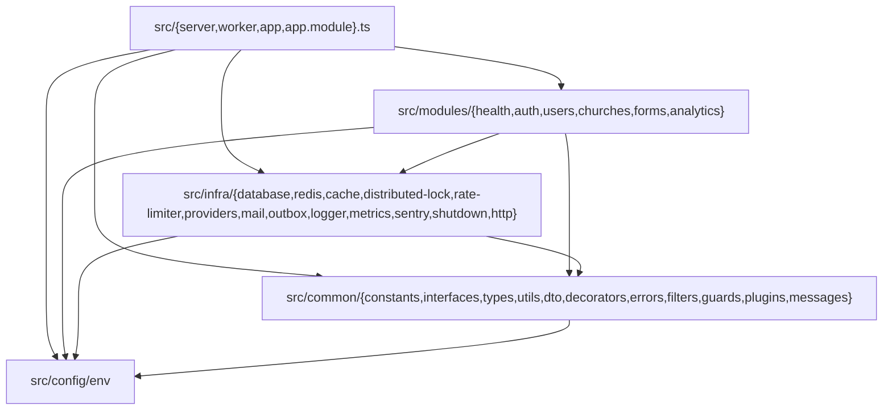

# NestJS Folder Organization — Phased Refactor Plan

Reorganizes `src/` from a horizontal, technical-layer-first folder layout (`http/`, `use-cases/`, `repositories/`, `providers/`, `core/`, `errors/`, `lib/`, `messages/`, `templates/`, `env/`) into a **NestJS module-based folder architecture** (`modules/`, `common/`, `config/`, `infra/`, composed via `app.module.ts`).

Scope: **directory structure, module boundaries, file naming conventions, path aliases, and the `/auth` route prefix separation — plus resolving the residual `ChurchPresenter` boundary note recorded in [`sonarqube-quality-gate.md`](sonarqube-quality-gate.md) §3b.** The runtime framework (Fastify 5), the `Result<T, E>` error-handling convention, `Deadline` budget propagation, `FailureMode`-driven provider chains, and manual factory wiring remain unchanged.

> **Status:** Completed (all Phases 0–8 executed and verified).

---

## 1. Architectural Decisions Record (ADR)

Every ambiguity and structural trade-off was resolved upfront and governs all phases below:

| # | Decision Area | Chosen Convention | Rationale |
| - | ------------- | ----------------- | --------- |
| **D1** | **Scope of NestJS adoption** | **Folder & module organization only** — keep Fastify runtime, `Result<T, E>` pattern, and manual factory wiring (no `@nestjs/core` DI container). | Achieves high domain cohesion and NestJS structural familiarity without introducing decorator/reflection runtime overhead or rewriting working Fastify plugins. |
| **D2** | **Top-level `src/` layout** | Explicit `src/modules/<feature>/`, `src/common/`, `src/config/`, and `src/infra/`, plus `src/app.module.ts`. | Separates domain feature modules (`modules/`) from cross-cutting HTTP/error/utility primitives (`common/`), environment validation (`config/`), and technical adapters (`infra/`). |
| **D3** | **Process entrypoints** | Keep `src/server.ts`, `src/worker.ts`, `src/app.ts`, and `src/metrics-server.ts` at `src/` root; add `src/app.module.ts`. | Preserves `package.json`, `Dockerfile`, PM2 `ecosystem.config.js`, and `scripts/ci-local.sh` build/runtime entrypoints without churn. |
| **D4** | **Internal module naming & service granularity** | Adopt canonical NestJS folder/file naming (`controllers/`, `services/*.service.ts`, `dto/*.dto.ts`, `presenters/*.presenter.ts`, `repositories/*.repository.ts`, `guards/*.guard.ts`, `filters/*.filter.ts`, `factories/make-*.service.ts`, `<feature>.module.ts`) with **one single-purpose service class per file**. | Keeping one service class per operation (e.g., `RegisterUserService` in `register-user.service.ts`) preserves Layer 4 complexity gates (`complexity ≤ 6`, `cognitive ≤ 10`, `max-lines-per-function ≤ 30`, `max-params ≤ 5`, Sonar 400-line file limit) and 1:1 unit test isolation. |
| **D5** | **Repository placement** | Colocate per feature module (`src/modules/<feature>/repositories/`) containing the repository interface,shared contract runner (`*.contract.ts`), `Prisma*Repository`, `InMemory*Repository`, and Prisma error-mapping tables. Shared Prisma client, `DatabaseContext`, and `PrismaErrorMapper` live in `src/infra/database/prisma/`. | Aligns with NestJS module encapsulation: everything required to understand, test, or evolve a domain aggregate lives inside its module. |
| **D6** | **`auth` vs. `users` separation & `/auth` route prefix** | Dedicated `src/modules/auth/` module mounted at `/auth` (`POST /auth/sessions`, `POST /auth/forgot-password`, `PATCH /auth/reset-password`) owning authentication, password reset, `authentication-audit` (service + repositories), and JWT/role guards (`verify-jwt.guard.ts`, `verify-user-role.guard.ts`). `src/modules/users/` remains mounted at `/users` and owns user registration, profile (`/users/me`), and admin CRUD/search. | Separates identity/session/credential lifecycles from user profile and account administration under distinct REST prefixes (`/auth` vs. `/users`). |
| **D7** | **DTOs vs. Presenters** | Place Zod validation schemas in `src/modules/<feature>/dto/*.dto.ts` and HTTP response presenters in `src/modules/<feature>/presenters/*.presenter.ts` (alongside domain projections under `presenters/projections/`). | Distinguishes inbound validation schemas (consumed by `fastify-type-provider-zod`) from outbound entity serialization. |
| **D8** | **Error hierarchy placement** | Move base errors (`AppError`, `DomainError`, `InfrastructureError`, `SystemError`, `AppErrorRegistry`, `infrastructure/*`) to `src/common/errors/`, HTTP error mappers/handlers to `src/common/filters/`, and domain-specific error classes (`src/use-cases/errors/*`) into their owning `src/modules/<feature>/errors/`. | Co-locates domain errors with the services that return them while keeping transport error serialization in `common/filters/`. |
| **D9** | **Messages & email templates** | Centralize PT-BR message catalogs (`src/messages/**`) under `src/common/messages/` and move React Email + plaintext templates (`src/templates/**`) under `src/infra/mail/templates/`. | Keeps `sonar.cpd.exclusions` and PT-BR copy catalogs in one place while co-locating email templates with the mail subsystem that renders them. |
| **D10** | **Test colocation & `tsconfig.json` aliases** | Keep all `*.spec.ts`, `*.integration.spec.ts`, `*.redis-integration.spec.ts`, `*.e2e.spec.ts`, and `*.acceptance.spec.mts` colocated inside the new folders; migrate `tsconfig.json` aliases to `@modules/*`, `@common/*`, `@config/*`, `@infra/*` (retiring legacy horizontal aliases in Phase 7); and resolve the `ChurchPresenter` boundary in Phase 8. | Preserves Vitest's project-based test isolation and replaces layer-coupled path aliases with module-aligned ones. |

---

## 2. Target Directory Structure & Dependency Graph

### 2.1 Dependency Direction Rules



- **`src/config/`** depends only on external packages (`zod`, `dotenv`).
- **`src/common/`** depends on `src/config/` (and `src/infra/logger`, `src/infra/sentry`, `src/infra/rate-limiter` in global HTTP filters/plugins). `AppErrorRegistry` in `src/common/errors/app-error-registry.ts` is the sole file in `common/` permitted to import domain error classes from `@modules/*/errors/*` for cache error deserialization.
- **`src/infra/`** depends on `src/common/` and `src/config/`. Outbox dispatch registry (`src/infra/outbox/jobs/make-outbox-dispatch-registry.ts`) wires dispatch strategies from `@modules/forms/strategies/*` and `@modules/auth/strategies/*`.
- **`src/modules/<feature>/`** depends on `src/common/`, `src/infra/`, `src/config/`, and exported guards/services from peer modules (specifically `@modules/auth/guards/*` and `@modules/auth/factories/make-authentication-audit.service`).

### 2.2 Complete Target Directory Tree (`src/`)

```text
src/
├── @types/
│   └── fastify_jwt.d.ts
├── app.ts                                              # Fastify instance + global plugin pipeline + mounts appModule
├── app.module.ts                                       # [NEW] Composes healthModule, authModule, usersModule, churchesModule, formsModule, analyticsModule
├── metrics-server.ts                                   # Dedicated Prometheus metrics HTTP server
├── server.ts                                           # API process entrypoint
├── worker.ts                                           # BullMQ / Outbox worker process entrypoint
│
├── config/                                             # (@config/*)
│   └── env/
│       ├── index.ts
│       ├── optional-env.ts
│       └── optional-env.spec.ts
│
├── common/                                             # (@common/*)
│   ├── constants/
│   │   ├── geo.ts
│   │   ├── http-status.ts                              # (from src/http/http-status.ts)
│   │   ├── pagination.ts
│   │   ├── time.ts
│   │   ├── upstream-http-status.ts
│   │   └── validation-limits.ts                        # (from src/http/schemas/validation-limits.ts)
│   ├── decorators/
│   │   ├── transactional-use-case.decorator.ts
│   │   └── transactional-use-case.decorator.spec.ts
│   ├── dto/
│   │   └── utils/                                      # (from src/http/schemas/utils/)
│   │       ├── cep.dto.ts
│   │       ├── cpf.dto.ts
│   │       ├── password.dto.ts
│   │       ├── public-id.dto.ts
│   │       └── username.dto.ts
│   ├── errors/
│   │   ├── app-error.ts
│   │   ├── app-error-registry.ts
│   │   ├── app-error-registry.spec.ts
│   │   ├── domain-error.ts
│   │   ├── infrastructure-error.ts
│   │   ├── system-error.ts
│   │   ├── prototype-chain-reached-through-error-lookup.regression.spec.ts
│   │   ├── provider-lost-in-error-round-trip.regression.spec.ts
│   │   └── infrastructure/
│   │       ├── circuit-open-error.ts
│   │       ├── circuit-open-error.spec.ts
│   │       ├── database-query-error.ts
│   │       ├── deadline-exceeded-error.ts
│   │       ├── provider-failure-error.ts
│   │       ├── provider-failure-error.spec.ts
│   │       ├── service-busy-error.ts
│   │       ├── service-overload-error.ts
│   │       └── timeout-exceeded-error.ts
│   ├── filters/                                        # (from src/errors/http-errors/ + src/http/plugins/error-handler*)
│   │   ├── error-handler.filter.ts
│   │   ├── error-handler.filter.spec.ts
│   │   ├── aborted-request-floods-sentry.regression.spec.ts
│   │   ├── http-error-mapper.ts
│   │   ├── http-error-mapper.spec.ts
│   │   ├── http-error-status.mapper.ts
│   │   ├── http-error-status.mapper.spec.ts
│   │   ├── zod-validation-error.ts
│   │   └── zod-validation-error.spec.ts
│   ├── guards/                                         # (from src/http/middlewares/verify-analytics-proxy*)
│   │   ├── verify-analytics-proxy.guard.ts
│   │   └── verify-analytics-proxy.guard.spec.ts
│   ├── interfaces/                                     # (from src/core/contracts/{async-local-storage,errors}/)
│   │   ├── app-error.interface.ts
│   │   ├── async-local-storage.interface.ts
│   │   ├── error-detail.interface.ts
│   │   └── error-mapper.interface.ts
│   ├── messages/                                       # (from src/messages/)
│   │   ├── constants/
│   │   │   ├── analytics/analytics.ts
│   │   │   ├── auth/{auth.ts,password-reset.ts}
│   │   │   ├── cache/cache.ts
│   │   │   ├── churches/churches.ts
│   │   │   ├── cron/cron.ts
│   │   │   ├── email/email.ts
│   │   │   ├── env/env.ts
│   │   │   ├── logs/{cache,distributed-lock,outbox,rate-limiter,redis,worker}.ts
│   │   │   ├── outbox/outbox.ts
│   │   │   ├── providers/{awesome-api,brasil-api,location-iq,nominatim,openrouteservice,shared,stadia,viacep}.ts
│   │   │   ├── queue/queue.ts
│   │   │   ├── redis/redis.ts
│   │   │   ├── validation/validation.ts
│   │   │   └── workers/workers.ts
│   │   └── errors/
│   │       └── {analytics,auth,churches,forms,geolocation,http,infrastructure,outbox,password-reset,queue,system,users,validation}.ts
│   ├── plugins/                                        # (from src/http/{plugins,policies,cookies}/)
│   │   ├── async-context.plugin.ts
│   │   ├── deadline.plugin.ts
│   │   ├── deadline.plugin.spec.ts
│   │   ├── rate-limit.plugin.ts
│   │   ├── rate-limit.plugin.spec.ts
│   │   ├── redis-outage-made-every-request-fail.regression.spec.ts
│   │   ├── request-lifecycle.plugin.ts
│   │   ├── load-shedding.acceptance.spec.mts
│   │   ├── security-headers.acceptance.spec.mts
│   │   ├── cookies/
│   │   │   ├── consent.ts
│   │   │   ├── consent.spec.ts
│   │   │   ├── cookie-secrets.ts
│   │   │   ├── cookie-secrets.spec.ts
│   │   │   ├── options.ts
│   │   │   └── options.spec.ts
│   │   └── policies/
│   │       ├── deadline.ts
│   │       └── rate-limit.ts
│   ├── types/                                          # (from src/core/types/ + src/http/types/)
│   │   ├── error-type/error-type.ts
│   │   ├── failure-mode/failure-mode.enum.ts
│   │   ├── patterns/result-pattern.ts
│   │   ├── routing-profile/routing-profile-enum.ts
│   │   ├── telemetry/telemetry-reason.enum.ts
│   │   └── zod-request.ts
│   └── utils/                                          # (from src/core/shared/ + src/core/validation/)
│       ├── abandoned-promise-unhandled-rejection.regression.spec.ts
│       ├── abort-race.ts
│       ├── abort-race.spec.ts
│       ├── deadline.ts
│       ├── deadline.spec.ts
│       ├── degenerate-budget-cancels-everything.regression.spec.ts
│       ├── email.ts
│       ├── result.ts
│       ├── result.spec.ts
│       ├── safe-lookup.ts
│       ├── stable-order.ts
│       └── stable-order.spec.ts
│
├── infra/                                              # (@infra/*)
│   ├── cache/                                          # (from src/lib/infra/cache/)
│   │   ├── cache-failure-policy.ts
│   │   ├── resilient-cache.ts
│   │   ├── resilient-cache.spec.ts
│   │   ├── resilient-cache-metrics.spec.ts
│   │   ├── resilient-cache.metrics-disabled.spec.ts
│   │   ├── resilient-cache.policies.spec.ts
│   │   ├── resilient-cache.integration.spec.ts
│   │   ├── resilient-cache.redis-integration.spec.ts
│   │   ├── result-discarded-at-deadline.regression.spec.ts
│   │   ├── shared-fetch-cancellation-bleed.regression.spec.ts
│   │   ├── single-flight-microtask-leak.regression.spec.ts
│   │   └── transient-failure-pinned-to-key.regression.spec.ts
│   ├── database/
│   │   └── prisma/                                     # (from src/lib/prisma/)
│   │       ├── index.ts
│   │       ├── statement-timeout-disabled-by-zero.regression.spec.ts
│   │       ├── helpers/
│   │       │   ├── configuration.ts
│   │       │   ├── database-context.ts
│   │       │   └── prisma-transaction-client.ts
│   │       └── utils/
│   │           ├── prisma-error-mapper.ts
│   │           └── prisma-error-mapper.spec.ts
│   ├── distributed-lock/                               # (from src/lib/infra/distributed-lock/)
│   │   ├── distributed-lock.ts
│   │   ├── distributed-lock.spec.ts
│   │   ├── distributed-lock.integration.spec.ts
│   │   └── with-distributed-lock.ts
│   ├── http/                                           # (from src/lib/http/)
│   │   ├── axios.ts
│   │   └── https-agent.ts
│   ├── logger/                                         # (from src/lib/logger/ + src/lib/async-local-storage/)
│   │   ├── helpers.ts
│   │   ├── helpers.spec.ts
│   │   ├── index.ts
│   │   ├── index.spec.ts
│   │   ├── logger.spec.ts
│   │   ├── logger-redact.spec.ts
│   │   ├── async-local-storage/
│   │   │   └── index.ts
│   │   └── errors/
│   │       └── async-local-storage-not-initialized-error.ts
│   ├── mail/                                           # (from src/lib/mail/, src/use-cases/email/, src/templates/, mail queue/worker)
│   │   ├── nodemailer-mail-sender.ts
│   │   ├── nodemailer-mail-sender.spec.ts
│   │   ├── nodemailer-mail-sender-circuit-breaker.spec.ts
│   │   ├── nodemailer-mail-sender.integration.spec.ts
│   │   ├── errors/
│   │   │   ├── job-already-processing-error.ts
│   │   │   └── smtp-dispatch-error.ts
│   │   ├── factories/
│   │   │   └── make-send-email.service.ts
│   │   ├── interfaces/
│   │   │   ├── mail-job-data.interface.ts
│   │   │   └── mail-sender.interface.ts
│   │   ├── queue/
│   │   │   ├── mail-queue.ts
│   │   │   └── mail-queue.spec.ts
│   │   ├── services/
│   │   │   ├── send-email.service.ts
│   │   │   └── send-email.service.spec.ts
│   │   ├── templates/                                  # (from src/templates/)
│   │   │   ├── contact-staff/{contact-staff-subject-text.ts,contact-staff-text.ts}
│   │   │   ├── contact-user/{contact-user-subject-text.ts,contact-user-text.ts}
│   │   │   ├── decision-for-christ-staff/{decision-for-christ-staff-subject-text.ts,decision-for-christ-staff-text.ts}
│   │   │   ├── decision-for-christ-user/{decision-for-christ-user-subject-text.ts,decision-for-christ-user-text.ts}
│   │   │   ├── forgot-password/forgot-password-text.ts
│   │   │   └── react/{contact-staff.tsx,contact-user.tsx,decision-for-christ-staff.tsx,decision-for-christ-user.tsx,forgot-password.tsx,layout.tsx}
│   │   └── workers/
│   │       ├── mail-worker.ts
│   │       ├── mail-worker.spec.ts
│   │       ├── mail-worker-metrics.spec.ts
│   │       └── mail-worker.integration.spec.ts
│   ├── metrics/                                        # (from src/lib/metrics/)
│   │   ├── analytics-metrics.ts
│   │   ├── bullmq-metrics.ts
│   │   ├── bullmq-metrics.spec.ts
│   │   ├── cache-metrics.ts
│   │   ├── email-metrics.ts
│   │   ├── index.ts
│   │   ├── index.spec.ts
│   │   ├── lock-metrics.ts
│   │   ├── outbox-metrics.ts
│   │   ├── provider-metrics.ts
│   │   ├── provider-metrics.spec.ts
│   │   └── rate-limiter-metrics.ts
│   ├── outbox/                                         # (from src/use-cases/outbox-event/, src/lib/infra/{events,jobs}/, outbox repos/queues/workers)
│   │   ├── errors/
│   │   │   ├── outbox-errors.ts
│   │   │   └── unknown-outbox-event-type-error.ts
│   │   ├── events/
│   │   │   ├── outbox-signal.ts
│   │   │   ├── outbox-signal.spec.ts
│   │   │   └── outbox-signal.integration.spec.ts
│   │   ├── interfaces/
│   │   │   ├── maintenance-job-data.interface.ts
│   │   │   ├── outbox-dispatch-data.interface.ts
│   │   │   ├── outbox-dispatch-strategy.interface.ts
│   │   │   ├── outbox-event.interface.ts
│   │   │   ├── outbox-event-input.ts
│   │   │   └── outbox-event-job-data.interface.ts
│   │   ├── jobs/
│   │   │   ├── analytics-retention.ts
│   │   │   ├── analytics-retention.spec.ts
│   │   │   ├── analytics-retention-metrics.spec.ts
│   │   │   ├── duplicate-scheduled-execution-across-pods.regression.spec.ts
│   │   │   ├── maintenance-scheduler.ts
│   │   │   ├── maintenance-scheduler.spec.ts
│   │   │   ├── maintenance-scheduler.redis-integration.spec.ts
│   │   │   ├── maintenance-worker.ts
│   │   │   ├── maintenance-worker.spec.ts
│   │   │   ├── maintenance-worker-metrics-disabled.spec.ts
│   │   │   ├── make-outbox-dispatch-registry.ts
│   │   │   ├── make-outbox-dispatch-registry.spec.ts
│   │   │   ├── outbox-dispatch-strategy-registry.ts
│   │   │   ├── outbox-dispatch-strategy-registry.spec.ts
│   │   │   ├── outbox-maintenance.ts
│   │   │   ├── outbox-maintenance.spec.ts
│   │   │   ├── outbox-metrics.spec.ts
│   │   │   ├── outbox-processor.ts
│   │   │   ├── outbox-processor.spec.ts
│   │   │   ├── outbox-processor.integration.spec.ts
│   │   │   ├── outbox-triage.ts
│   │   │   └── outbox-triage.spec.ts
│   │   ├── queue/
│   │   │   ├── maintenance-queue.ts
│   │   │   ├── maintenance-queue.spec.ts
│   │   │   ├── outbox-dispatch-queue.ts
│   │   │   └── outbox-dispatch-queue.spec.ts
│   │   ├── repositories/
│   │   │   ├── outbox-repository.interface.ts
│   │   │   ├── in-memory-outbox.repository.ts
│   │   │   ├── in-memory-outbox.repository.spec.ts
│   │   │   ├── prisma-outbox-event.repository.ts
│   │   │   ├── prisma-outbox-event.repository.spec.ts
│   │   │   └── errors/
│   │   │       └── outbox-error-mapping.ts
│   │   ├── services/
│   │   │   ├── outbox-event.service.ts
│   │   │   └── outbox-event.service.spec.ts
│   │   └── workers/
│   │       ├── outbox-dispatch-worker.ts
│   │       └── outbox-dispatch-worker.spec.ts
│   ├── providers/                                      # (from src/providers/ + src/core/contracts/use-cases/providers/)
│   │   ├── interfaces/
│   │   │   ├── address-provider.interface.ts
│   │   │   ├── church-routing-provider.interface.ts
│   │   │   ├── geo-provider.interface.ts
│   │   │   └── raw-providers.interface.ts
│   │   ├── helpers/
│   │   │   ├── cancellation-ignored-during-backoff.regression.spec.ts
│   │   │   ├── cockatiel-policy-contract.spec.ts
│   │   │   ├── deadline-retry.ts
│   │   │   ├── deadline-retry.spec.ts
│   │   │   ├── guarded-attempt.ts
│   │   │   ├── precision-helper.ts
│   │   │   ├── precision-helper.spec.ts
│   │   │   ├── provider-admission.ts
│   │   │   ├── provider-admission.spec.ts
│   │   │   ├── provider-chain.ts
│   │   │   ├── provider-circuit-breaker.ts
│   │   │   ├── provider-circuit-breaker.spec.ts
│   │   │   ├── provider-http-client.ts
│   │   │   ├── rate-limit-consumed-after-abort.regression.spec.ts
│   │   │   └── retryable-failure.ts
│   │   ├── address-provider/
│   │   │   ├── awesome-api-provider.ts
│   │   │   ├── awesome-api-provider.spec.ts
│   │   │   ├── brasil-api-provider.ts
│   │   │   ├── brasil-api-provider.spec.ts
│   │   │   ├── resilient-address-provider.ts
│   │   │   ├── resilient-address-provider.spec.ts
│   │   │   ├── resilient-address-provider.integration.spec.ts
│   │   │   ├── viaCep-provider.ts
│   │   │   ├── viaCep-provider.spec.ts
│   │   │   ├── decorators/
│   │   │   │   ├── resilient-address-provider.decorator.ts
│   │   │   │   └── resilient-address-provider.decorator.spec.ts
│   │   │   └── error/
│   │   │       └── no-address-provider-error.ts
│   │   ├── church-routing-provider/
│   │   │   ├── openrouteservice-church-routing-provider.ts
│   │   │   ├── openrouteservice-church-routing-provider.spec.ts
│   │   │   ├── resilient-church-routing-provider.ts
│   │   │   ├── resilient-church-routing-provider.spec.ts
│   │   │   ├── routing-matrix.ts
│   │   │   ├── routing-matrix.spec.ts
│   │   │   ├── stadia-church-routing-provider.ts
│   │   │   ├── stadia-church-routing-provider.spec.ts
│   │   │   ├── decorators/
│   │   │   │   ├── resilient-church-routing-provider.decorator.ts
│   │   │   │   └── resilient-church-routing-provider.decorator.spec.ts
│   │   │   └── error/
│   │   │       └── no-routing-provider-error.ts
│   │   └── geo-provider/
│   │       ├── expired-budget-walks-whole-chain.regression.spec.ts
│   │       ├── location-iq-provider.ts
│   │       ├── location-iq-provider.spec.ts
│   │       ├── nominatim-provider.ts
│   │       ├── nominatim-provider.spec.ts
│   │       ├── resilient-geo-provider.ts
│   │       ├── resilient-geo-provider.spec.ts
│   │       ├── decorators/
│   │       │   ├── resilient-geocoding-provider.decorator.ts
│   │       │   └── resilient-geocoding-provider.decorator.spec.ts
│   │       └── error/
│   │           └── no-geo-provider-error.ts
│   ├── rate-limiter/                                   # (from src/lib/infra/rate-limiter/)
│   │   ├── outage-reporter.ts
│   │   ├── outage-reporter.spec.ts
│   │   ├── rate-limit-health-probe.ts
│   │   ├── rate-limit-health-probe.spec.ts
│   │   ├── rate-limiter.spec.ts
│   │   ├── rate-limiter-metrics.spec.ts
│   │   ├── redis-rate-limiter.ts
│   │   └── redis-rate-limiter.integration.spec.ts
│   ├── redis/                                          # (from src/lib/redis/)
│   │   ├── clients/
│   │   │   └── clients.ts
│   │   └── connections/
│   │       ├── attach-outage-logging.ts
│   │       ├── attach-outage-logging.spec.ts
│   │       ├── redis-bullMQ-connection.ts
│   │       ├── redis-bullMQ-connection.spec.ts
│   │       ├── redis-cache-connection.ts
│   │       ├── redis-cache-connection.spec.ts
│   │       ├── redis-outage-logger.ts
│   │       ├── redis-outage-logger.spec.ts
│   │       ├── redis-outbox-signal-connection.ts
│   │       ├── redis-rate-limiter-connection.ts
│   │       └── redis-rate-limiter-connection.spec.ts
│   ├── sentry/                                         # (from src/lib/sentry/)
│   │   ├── capture.ts
│   │   ├── capture.spec.ts
│   │   ├── init.ts
│   │   └── init.spec.ts
│   └── shutdown/                                       # (from src/lib/shutdown/)
│       ├── crash-cleanup-interrupted-by-duplicate-handler.regression.spec.ts
│       ├── crash-shutdown.ts
│       └── crash-shutdown.spec.ts
│
├── modules/                                            # (@modules/*)
│   ├── health/
│   │   ├── health.module.ts
│   │   └── health-check.acceptance.spec.mts
│   │
│   ├── auth/                                           # Mounted at /auth
│   │   ├── auth.module.ts                              # POST /auth/sessions, POST /auth/forgot-password, PATCH /auth/reset-password
│   │   ├── controllers/
│   │   │   ├── authenticate-user.controller.ts
│   │   │   ├── forgot-password.controller.ts
│   │   │   └── reset-password.controller.ts
│   │   ├── dto/
│   │   │   ├── authenticate.dto.ts
│   │   │   ├── forgot-password.dto.ts
│   │   │   └── reset-password.dto.ts
│   │   ├── errors/
│   │   │   ├── invalid-credentials-error.ts
│   │   │   ├── invalid-password-reset-payload-error.ts
│   │   │   └── invalid-token-error.ts
│   │   ├── factories/
│   │   │   ├── make-authenticate-user.service.ts
│   │   │   ├── make-authentication-audit.service.ts
│   │   │   ├── make-forgot-password.service.ts
│   │   │   └── make-reset-password.service.ts
│   │   ├── guards/
│   │   │   ├── verify-jwt.guard.ts
│   │   │   ├── verify-jwt.guard.spec.ts
│   │   │   ├── verify-user-role.guard.ts
│   │   │   └── verify-user-role.guard.spec.ts
│   │   ├── helpers/
│   │   │   ├── token-hash.ts
│   │   │   └── token-hash.spec.ts
│   │   ├── repositories/
│   │   │   ├── authentication-audit-repository.interface.ts
│   │   │   ├── in-memory-authentication-audit.repository.ts
│   │   │   └── prisma-authentication-audit.repository.ts
│   │   ├── services/
│   │   │   ├── authenticate-user.service.ts
│   │   │   ├── authenticate-user.service.spec.ts
│   │   │   ├── authentication-audit.service.ts
│   │   │   ├── authentication-audit.service.spec.ts
│   │   │   ├── forgot-password.service.ts
│   │   │   ├── forgot-password.service.spec.ts
│   │   │   ├── reset-password.service.ts
│   │   │   └── reset-password.service.spec.ts
│   │   └── strategies/
│   │       ├── password-reset-dispatch.strategy.ts
│   │       ├── password-reset-dispatch.strategy.spec.ts
│   │       └── password-reset-html-rendering.spec.ts
│   │
│   ├── users/                                          # Mounted at /users
│   │   ├── users.module.ts                             # /users/register, /users/register/admin, /users/me, /users, /users/search, /users/:publicId
│   │   ├── controllers/
│   │   │   ├── delete-user.controller.ts
│   │   │   ├── get-user-profile.controller.ts
│   │   │   ├── list-users.controller.ts
│   │   │   ├── register-user.controller.ts
│   │   │   ├── search-users.controller.ts
│   │   │   ├── search-users.controller.spec.ts
│   │   │   ├── search-users.e2e.spec.ts
│   │   │   ├── search-users-leaks-password-hash.regression.spec.ts
│   │   │   └── update-user.controller.ts
│   │   ├── dto/
│   │   │   ├── register-user.dto.ts
│   │   │   ├── search-users.dto.ts
│   │   │   └── update-user.dto.ts
│   │   ├── errors/
│   │   │   ├── user-already-exists-error.ts
│   │   │   ├── user-not-created-error.ts
│   │   │   └── user-not-found-error.ts
│   │   ├── factories/
│   │   │   ├── make-delete-user.service.ts
│   │   │   ├── make-get-user-profile.service.ts
│   │   │   ├── make-list-users.service.ts
│   │   │   ├── make-register-user.service.ts
│   │   │   ├── make-search-users.service.ts
│   │   │   └── make-update-user.service.ts
│   │   ├── presenters/
│   │   │   ├── user.presenter.ts
│   │   │   └── user.presenter.spec.ts
│   │   ├── repositories/
│   │   │   ├── users-repository.interface.ts
│   │   │   ├── in-memory-users.repository.ts
│   │   │   ├── prisma-users.repository.ts
│   │   │   └── errors/
│   │   │       ├── users-error-mapping.ts
│   │   │       └── error-mappings.spec.ts
│   │   └── services/
│   │       ├── delete-user.service.ts
│   │       ├── delete-user.service.spec.ts
│   │       ├── get-user-profile.service.ts
│   │       ├── get-user-profile.service.spec.ts
│   │       ├── list-users.service.ts
│   │       ├── list-users.service.spec.ts
│   │       ├── register-user.service.ts
│   │       ├── register-user.service.spec.ts
│   │       ├── search-users.service.ts
│   │       ├── search-users.service.spec.ts
│   │       ├── update-user.service.ts
│   │       └── update-user.service.spec.ts
│   │
│   ├── churches/                                       # Mounted at /churches
│   │   ├── churches.module.ts
│   │   ├── controllers/
│   │   │   ├── api-providers-fallback-strategy.e2e.spec.ts
│   │   │   ├── churches-rate-limit.e2e.spec.ts
│   │   │   ├── create-church.controller.ts
│   │   │   ├── delete-church.controller.ts
│   │   │   ├── find-church-publicId-by-name.controller.ts
│   │   │   ├── find-nearest-churches.controller.ts
│   │   │   └── find-nearest-churches.controller.spec.ts
│   │   ├── dto/
│   │   │   ├── create-church.dto.ts
│   │   │   ├── delete-church.dto.ts
│   │   │   └── find-church-by-name.dto.ts
│   │   ├── errors/
│   │   │   ├── cep-to-lat-lon-error.ts
│   │   │   ├── church-already-exists-error.ts
│   │   │   ├── church-not-found-error.ts
│   │   │   ├── coordinates-not-found-error.ts
│   │   │   ├── create-church-error.ts
│   │   │   ├── empty-church-list-error.ts
│   │   │   ├── invalid-cep-error.ts
│   │   │   ├── latitude-range-error.ts
│   │   │   ├── longitude-range-error.ts
│   │   │   ├── no-address-error.ts
│   │   │   ├── no-nearby-churches-found-error.ts
│   │   │   └── mappings/
│   │   │       ├── find-nearest-churches-error-mapper.ts
│   │   │       └── find-nearest-churches-error-mapper.spec.ts
│   │   ├── factories/
│   │   │   ├── make-create-church.service.ts
│   │   │   ├── make-delete-church.service.ts
│   │   │   ├── make-find-church-publicId-by-name.service.ts
│   │   │   ├── make-find-nearest-churches.service.ts
│   │   │   └── nearest-churches-503-when-stadia-rejects.regression.spec.ts
│   │   ├── presenters/
│   │   │   ├── church.presenter.ts
│   │   │   ├── church.presenter.spec.ts
│   │   │   └── projections/
│   │   │       └── public-church.ts
│   │   ├── repositories/
│   │   │   ├── churches-repository.interface.ts
│   │   │   ├── churches-repository.contract.ts
│   │   │   ├── in-memory-churches.repository.ts        # (fixes typo in-memory-chuches-repository.ts)
│   │   │   ├── in-memory-churches.repository.spec.ts
│   │   │   ├── in-memory-churches.repository.contract.spec.ts
│   │   │   ├── prisma-churches.repository.ts
│   │   │   ├── prisma-churches.repository.spec.ts
│   │   │   ├── prisma-churches.repository.integration.spec.ts
│   │   │   └── errors/
│   │   │       └── churches-error-mapping.ts
│   │   └── services/
│   │       ├── calculate-church-route-distances.service.ts
│   │       ├── calculate-church-route-distances.service.spec.ts
│   │       ├── cep-to-lat-lon.service.ts
│   │       ├── cep-to-lat-lon.service.spec.ts
│   │       ├── church-lookup-cache-policy.ts
│   │       ├── church-lookup-cache-policy.spec.ts
│   │       ├── create-church.service.ts
│   │       ├── create-church.service.spec.ts
│   │       ├── delete-church.service.ts
│   │       ├── delete-church.service.spec.ts
│   │       ├── distant-church-presented-as-nearest.regression.spec.ts
│   │       ├── find-church-publicId-by-name.service.ts
│   │       ├── find-church-publicId-by-name.service.spec.ts
│   │       ├── find-nearby-churches-knn.service.ts
│   │       ├── find-nearby-churches-knn.service.spec.ts
│   │       ├── find-nearby-churches-knn-budget.spec.ts
│   │       ├── find-nearest-churches.service.ts
│   │       ├── find-nearest-churches.service.spec.ts
│   │       ├── find-nearest-churches-orchestration.service.spec.ts
│   │       ├── request-outlives-its-budget.regression.spec.ts
│   │       ├── routed-distance-ceiling.spec.ts
│   │       └── system-error-pinned-by-negative-cache.regression.spec.ts
│   │
│   ├── forms/                                          # Mounted at /forms
│   │   ├── forms.module.ts
│   │   ├── controllers/
│   │   │   ├── form.controller.ts
│   │   │   └── forms.integration.spec.ts
│   │   ├── dto/
│   │   │   ├── form-payload.type.ts
│   │   │   └── forms.dto.ts
│   │   ├── errors/
│   │   │   ├── form-submission-error.ts
│   │   │   ├── forms-already-exists-error.ts
│   │   │   ├── forms-not-found-error.ts
│   │   │   ├── forms-submission-error.ts
│   │   │   └── invalid-form-payload-error.ts
│   │   ├── factories/
│   │   │   └── make-form-submission.service.ts
│   │   ├── repositories/
│   │   │   ├── forms-repository.interface.ts
│   │   │   ├── in-memory-forms-submission.repository.ts
│   │   │   ├── prisma-forms.repository.ts
│   │   │   └── errors/
│   │   │       └── forms-error-mapping.ts
│   │   ├── services/
│   │   │   ├── forms-submission.service.ts
│   │   │   └── forms-submission.service.spec.ts
│   │   └── strategies/
│   │       ├── contact-email.strategy.ts
│   │       ├── contact-email.strategy.spec.ts
│   │       ├── contact-email-html-rendering.spec.ts
│   │       ├── decision-for-christ-email.strategy.ts
│   │       ├── decision-for-christ-email.strategy.spec.ts
│   │       ├── decision-for-christ-html-rendering.spec.ts
│   │       ├── email-strategy.interface.ts
│   │       ├── form-payload-fields.ts
│   │       ├── form-submission-dispatch.strategy.ts
│   │       └── form-submission-dispatch.strategy.spec.ts
│   │
│   └── analytics/                                      # Mounted at /analytics
│       ├── analytics.module.ts
│       ├── controllers/
│       │   ├── analytics.e2e.spec.ts
│       │   ├── erase-my-data.controller.ts
│       │   ├── get-visitor-analytics.controller.ts
│       │   ├── identify-visitor.controller.ts
│       │   ├── list-visitors-by-user.controller.ts
│       │   ├── revoke-consent.controller.ts
│       │   ├── session-context.ts
│       │   ├── session-context.spec.ts
│       │   ├── start-session.controller.ts
│       │   └── track-event.controller.ts
│       ├── dto/
│       │   ├── track-event.dto.ts
│       │   └── visitor-analytics.dto.ts
│       ├── errors/
│       │   └── visitor-not-found-error.ts
│       ├── factories/
│       │   ├── make-erase-analytics-data.service.ts
│       │   ├── make-get-visitor-analytics.service.ts
│       │   ├── make-identify-visitor.service.ts
│       │   ├── make-start-analytics-session.service.ts
│       │   └── make-track-analytics.service.ts
│       ├── helpers/
│       │   ├── compressed-ipv6-stored-no-address.regression.spec.ts
│       │   ├── truncate-ip.ts
│       │   ├── truncate-ip.spec.ts
│       │   ├── user-agent-parser.ts
│       │   └── user-agent-parser.spec.ts
│       ├── plugins/
│       │   ├── analytics-identity.plugin.ts
│       │   ├── analytics-identity-metrics-off.spec.ts
│       │   └── analytics-identity-rotation.spec.ts
│       ├── presenters/
│       │   ├── analytics.presenter.ts
│       │   ├── analytics.presenter.spec.ts
│       │   └── projections/
│       │       └── analytics-session-attributes.ts
│       ├── repositories/
│       │   ├── analytics-repository.interface.ts
│       │   ├── analytics-repository.contract.ts
│       │   ├── in-memory-analytics.repository.ts
│       │   ├── in-memory-analytics.repository.spec.ts
│       │   ├── in-memory-analytics.repository.contract.spec.ts
│       │   ├── prisma-analytics.repository.ts
│       │   ├── prisma-analytics.repository.integration.spec.ts
│       │   └── visitor-user-link-wiped-by-anonymous-upsert.regression.spec.ts
│       └── services/
│           ├── erase-analytics-data.service.ts
│           ├── erase-analytics-data.service.spec.ts
│           ├── get-visitor-analytics.service.ts
│           ├── get-visitor-analytics.service.spec.ts
│           ├── identify-visitor.service.ts
│           ├── identify-visitor.service.spec.ts
│           ├── start-analytics-session.service.ts
│           ├── start-analytics-session.service.spec.ts
│           ├── track-analytics.service.ts
│           └── track-analytics.service.spec.ts
│
└── load-test/
    ├── fixtures/valid_ceps.json
    ├── load-test-authenticate.k6.js
    ├── load-test-create-church.k6.js
    ├── load-test-emails.ts
    ├── load-test-find-nearest-churches.k6.js
    └── load-test-resilient-cache.k6.js
```

---

## 3. Path Alias Migration Strategy (`tsconfig.json`)

To make each phase independently shippable without breaking untouched modules, **`tsconfig.json` uses a two-step alias lifecycle**:

1. **Phase 0 (Coexistence):** Add the new NestJS aliases (`@config/*`, `@common/*`, `@infra/*`, `@modules/*`) alongside the existing horizontal aliases. As each folder moves in Phases 1–6, update its corresponding legacy alias target in `tsconfig.json` (or update callers directly to the new alias) so `tsc --noEmit` and `vite-tsconfig-paths` stay green at every intermediate commit.
2. **Phase 7 (Retirement):** Once all files reside in `config/`, `common/`, `infra/`, and `modules/`, rewrite any remaining legacy alias imports to `@config/*`, `@common/*`, `@infra/*`, `@modules/*` and delete the legacy aliases.

### Final `tsconfig.json` `paths` (After Phase 7)

```json
{
  "compilerOptions": {
    "paths": {
      "app": ["./src/app.ts"],
      "@config/*": ["./src/config/*"],
      "@common/*": ["./src/common/*"],
      "@infra/*": ["./src/infra/*"],
      "@modules/*": ["./src/modules/*"],
      "@tps/*": ["./src/@types/*"]
    }
  }
}
```

---

## 4. Phase-by-Phase Execution Plan

### Phase 0 — Baseline Verification & Alias Scaffolding

**Objective:** Confirm the tree is 100% green before moving a single file, and register the new `@config/*`, `@common/*`, `@infra/*`, and `@modules/*` path aliases in `tsconfig.json`.

1. Run `npm run ci:local` on the clean working tree to establish the baseline.
2. Add `@config/*`, `@common/*`, `@infra/*`, and `@modules/*` to `tsconfig.json` `compilerOptions.paths`.
3. Run `npm run verify` to confirm zero regressions.

---

### Phase 1 — Configuration & Common Foundation (`src/config/` & `src/common/`)

Moves the innermost layers (`env`, `core` primitives, `messages`, base `errors`, and global HTTP `filters`/`guards`/`plugins`) that have no upward dependencies on feature modules.

#### Phase 1a — Environment Configuration (`src/config/env/`)

| Action | Current Path | Target Path |
| ------ | ------------ | ----------- |
| `git mv` | `src/env/index.ts` | `src/config/env/index.ts` |
| `git mv` | `src/env/optional-env.ts` | `src/config/env/optional-env.ts` |
| `git mv` | `src/env/optional-env.spec.ts` | `src/config/env/optional-env.spec.ts` |

**Touchpoints to update in lockstep:**
- `tsconfig.json`: Point `@env/*` temporarily to `["./src/config/env/*"]` while migrating imports to `@config/env/*`.
- `prisma/seed.ts`: Update `../src/env` → `../src/config/env`.
- `vite.config.mts`: Update `unit-env` project `dir: 'src/config/env'`.
- `stryker.conf.mjs`: Update `!src/env/index.ts` → `!src/config/env/index.ts`.
- `sonar-project.properties`: Update `sonar.coverage.exclusions` (`src/config/env/index.ts`) and `sonar.issue.ignore.multicriteria.e1.resourceKey=src/config/env/index.ts`.

**Gate:** Full per-change gate + `npm run test:mutation:scoped -- "src/config/env/**/*.ts"`.

---

#### Phase 1b — Common Primitives, Shared DTO Utils, Decorators & Messages (`src/common/`)

| Action | Current Path | Target Path |
| ------ | ------------ | ----------- |
| `git mv` | `src/core/constants/geo.ts` | `src/common/constants/geo.ts` |
| `git mv` | `src/core/constants/pagination.ts` | `src/common/constants/pagination.ts` |
| `git mv` | `src/core/constants/time.ts` | `src/common/constants/time.ts` |
| `git mv` | `src/core/constants/upstream-http-status.ts` | `src/common/constants/upstream-http-status.ts` |
| `git mv` | `src/http/http-status.ts` | `src/common/constants/http-status.ts` |
| `git mv` | `src/http/schemas/validation-limits.ts` | `src/common/constants/validation-limits.ts` |
| `git mv` | `src/core/contracts/async-local-storage/async-local-storage.interface.ts` | `src/common/interfaces/async-local-storage.interface.ts` |
| `git mv` | `src/core/contracts/errors/app-error.interface.ts` | `src/common/interfaces/app-error.interface.ts` |
| `git mv` | `src/core/contracts/errors/error-detail.interface.ts` | `src/common/interfaces/error-detail.interface.ts` |
| `git mv` | `src/core/contracts/errors/error-mapper.interface.ts` | `src/common/interfaces/error-mapper.interface.ts` |
| `git mv` | `src/core/types/error-type/error-type.ts` | `src/common/types/error-type/error-type.ts` |
| `git mv` | `src/core/types/failure-mode/failure-mode.enum.ts` | `src/common/types/failure-mode/failure-mode.enum.ts` |
| `git mv` | `src/core/types/patterns/result-pattern.ts` | `src/common/types/patterns/result-pattern.ts` |
| `git mv` | `src/core/types/routing-profile/routing-profile-enum.ts` | `src/common/types/routing-profile/routing-profile-enum.ts` |
| `git mv` | `src/core/types/telemetry/telemetry-reason.enum.ts` | `src/common/types/telemetry/telemetry-reason.enum.ts` |
| `git mv` | `src/http/types/zod-request.ts` | `src/common/types/zod-request.ts` |
| `git mv` | `src/core/shared/*` (all 11 files + specs) | `src/common/utils/*` |
| `git mv` | `src/core/validation/email.ts` | `src/common/utils/email.ts` |
| `git mv` | `src/http/schemas/utils/cep.ts` | `src/common/dto/utils/cep.dto.ts` |
| `git mv` | `src/http/schemas/utils/cpf.ts` | `src/common/dto/utils/cpf.dto.ts` |
| `git mv` | `src/http/schemas/utils/password.ts` | `src/common/dto/utils/password.dto.ts` |
| `git mv` | `src/http/schemas/utils/public-id-schema.ts` | `src/common/dto/utils/public-id.dto.ts` |
| `git mv` | `src/http/schemas/utils/username.ts` | `src/common/dto/utils/username.dto.ts` |
| `git mv` | `src/use-cases/decorators/transactional-use-case.decorator.ts` (& `.spec.ts`) | `src/common/decorators/transactional-use-case.decorator.ts` (& `.spec.ts`) |
| `git mv` | `src/messages/**` (all 40 files under `constants/` and `errors/`) | `src/common/messages/**` |

**Touchpoints to update in lockstep:**
- `tsconfig.json`: Point `messages/*` temporarily to `["./src/common/messages/*"]` while migrating imports to `@common/*`.
- `scripts/outbox-triage.ts`: Update `../src/core/shared/result` → `../src/common/utils/result`.
- `vite.config.mts`: Update coverage exclusions (`src/common/interfaces/**`, `src/common/types/**`) and `unit-core` project `dir: 'src/common'`.
- `sonar-project.properties`:
  - `sonar.coverage.exclusions`: `src/messages/**` → `src/common/messages/**`
  - `sonar.cpd.exclusions`: `src/messages/**` → `src/common/messages/**`
  - `sonar.issue.ignore.multicriteria.e10.resourceKey=src/common/utils/stable-order.ts`

**Gate:** Full per-change gate + `npm run test:mutation:scoped -- "src/common/utils/**/*.ts" "src/common/decorators/**/*.ts" "src/common/dto/**/*.ts"`.

---

#### Phase 1c — Base Errors, HTTP Filters, Common Guards & Global Fastify Plugins (`src/common/{errors,filters,guards,plugins}/`)

| Action | Current Path | Target Path |
| ------ | ------------ | ----------- |
| `git mv` | `src/errors/app-error.ts` | `src/common/errors/app-error.ts` |
| `git mv` | `src/errors/domain-error.ts` | `src/common/errors/domain-error.ts` |
| `git mv` | `src/errors/infrastructure-error.ts` | `src/common/errors/infrastructure-error.ts` |
| `git mv` | `src/errors/system-error.ts` | `src/common/errors/system-error.ts` |
| `git mv` | `src/errors/app-error-registry.ts` (& `.spec.ts`) | `src/common/errors/app-error-registry.ts` (& `.spec.ts`) |
| `git mv` | `src/errors/prototype-chain-reached-through-error-lookup.regression.spec.ts` | `src/common/errors/prototype-chain-reached-through-error-lookup.regression.spec.ts` |
| `git mv` | `src/errors/provider-lost-in-error-round-trip.regression.spec.ts` | `src/common/errors/provider-lost-in-error-round-trip.regression.spec.ts` |
| `git mv` | `src/errors/infrastructure/*` (all 9 files + specs) | `src/common/errors/infrastructure/*` |
| `git mv` | `src/errors/http-errors/http-error-mapper.ts` (& `.spec.ts`) | `src/common/filters/http-error-mapper.ts` (& `.spec.ts`) |
| `git mv` | `src/errors/http-errors/http-error-status.mapper.ts` (& `.spec.ts`) | `src/common/filters/http-error-status.mapper.ts` (& `.spec.ts`) |
| `git mv` | `src/errors/http-errors/zod-validation-error.ts` (& `.spec.ts`) | `src/common/filters/zod-validation-error.ts` (& `.spec.ts`) |
| `git mv` | `src/http/plugins/error-handler.plugin.ts` (& `.spec.ts`) | `src/common/filters/error-handler.filter.ts` (& `.spec.ts`) |
| `git mv` | `src/http/plugins/aborted-request-floods-sentry.regression.spec.ts` | `src/common/filters/aborted-request-floods-sentry.regression.spec.ts` |
| `git mv` | `src/http/middlewares/verify-analytics-proxy.middleware.ts` (& `.spec.ts`) | `src/common/guards/verify-analytics-proxy.guard.ts` (& `.spec.ts`) |
| `git mv` | `src/http/plugins/async-context.plugin.ts` | `src/common/plugins/async-context.plugin.ts` |
| `git mv` | `src/http/plugins/deadline.plugin.ts` (& `.spec.ts`) | `src/common/plugins/deadline.plugin.ts` (& `.spec.ts`) |
| `git mv` | `src/http/plugins/rate-limit.plugin.ts` (& `.spec.ts`) | `src/common/plugins/rate-limit.plugin.ts` (& `.spec.ts`) |
| `git mv` | `src/http/plugins/redis-outage-made-every-request-fail.regression.spec.ts` | `src/common/plugins/redis-outage-made-every-request-fail.regression.spec.ts` |
| `git mv` | `src/http/plugins/request-lifecycle.plugin.ts` | `src/common/plugins/request-lifecycle.plugin.ts` |
| `git mv` | `src/http/plugins/load-shedding.acceptance.spec.mts` | `src/common/plugins/load-shedding.acceptance.spec.mts` |
| `git mv` | `src/http/plugins/security-headers.acceptance.spec.mts` | `src/common/plugins/security-headers.acceptance.spec.mts` |
| `git mv` | `src/http/cookies/*` (6 files) | `src/common/plugins/cookies/*` |
| `git mv` | `src/http/policies/*` (2 files) | `src/common/plugins/policies/*` |

**Touchpoints to update in lockstep:**
- `eslint.config.mjs`: Add `'src/common/plugins/**/*.ts'` and `'src/common/filters/**/*.ts'` to the `require-await` exemption block.
- `sonar-project.properties`:
  - `sonar.issue.ignore.multicriteria.e8.resourceKey=src/common/**/*.ts` (or keep alongside `src/modules/**/*.ts` for Fastify hooks).
  - `sonar.issue.ignore.multicriteria.e9.resourceKey=src/common/errors/app-error-registry.ts`.
- `vite.config.mts`: Update `unit-errors` (`dir: 'src/common/errors'`), `unit-http` (include `src/common/{filters,guards,plugins}/**/*.spec.ts`), and `acceptance` (`dir: 'src'`, `include: ['**/*.acceptance.spec.mts']`).

**Gate:** Full per-change gate + `npm run test:mutation:scoped -- "src/common/errors/**/*.ts" "src/common/filters/**/*.ts" "src/common/guards/**/*.ts" "src/common/plugins/**/*.ts"`.

---

### Phase 2 — Infrastructure Layer (`src/infra/`)

Consolidates all technical adapters (`lib/`, `providers/`, email sending/templates, and the outbox/maintenance job machinery) under `src/infra/`.

#### Phase 2a — Observability, Shutdown, HTTP Client & Redis Connections (`src/infra/{logger,metrics,sentry,shutdown,http,redis}/`)

| Action | Current Path | Target Path |
| ------ | ------------ | ----------- |
| `git mv` | `src/lib/logger/*` (6 files) | `src/infra/logger/*` |
| `git mv` | `src/lib/async-local-storage/index.ts` | `src/infra/logger/async-local-storage/index.ts` |
| `git mv` | `src/lib/errors/async-local-storage/async-local-storage-not-initialized-error.ts` | `src/infra/logger/errors/async-local-storage-not-initialized-error.ts` |
| `git mv` | `src/lib/metrics/*` (12 files) | `src/infra/metrics/*` |
| `git mv` | `src/lib/sentry/*` (4 files) | `src/infra/sentry/*` |
| `git mv` | `src/lib/shutdown/*` (3 files) | `src/infra/shutdown/*` |
| `git mv` | `src/lib/http/*` (2 files) | `src/infra/http/*` |
| `git mv` | `src/lib/redis/**` (12 files) | `src/infra/redis/**` |

**Touchpoints to update in lockstep:**
- `eslint.config.mjs`: Update `no-process-exit` exemption from `'src/lib/shutdown/**/*.ts'` → `'src/infra/shutdown/**/*.ts'`.
- `sonar-project.properties`: Update `sonar.issue.ignore.multicriteria.e2.resourceKey=src/infra/metrics/**/*.ts`.
- `vite.config.mts`: Point `unit-lib` to `dir: 'src/infra'`.

**Gate:** Full per-change gate + `npm run test:mutation:scoped -- "src/infra/{logger,metrics,sentry,shutdown,http,redis}/**/*.ts"`.

---

#### Phase 2b — Resilience Primitives & Prisma Database Adapter (`src/infra/{cache,distributed-lock,rate-limiter,database/prisma}/`)

| Action | Current Path | Target Path |
| ------ | ------------ | ----------- |
| `git mv` | `src/lib/infra/cache/*` (12 files) | `src/infra/cache/*` |
| `git mv` | `src/lib/infra/distributed-lock/*` (4 files) | `src/infra/distributed-lock/*` |
| `git mv` | `src/lib/infra/rate-limiter/*` (8 files) | `src/infra/rate-limiter/*` |
| `git mv` | `src/lib/prisma/**` (6 files) | `src/infra/database/prisma/**` |
| `git mv` | `src/repositories/prisma/statement-timeout-disabled-by-zero.regression.spec.ts` | `src/infra/database/prisma/statement-timeout-disabled-by-zero.regression.spec.ts` |

**Touchpoints to update in lockstep:**
- `eslint.config.mjs`: Update `sonarjs/redundant-type-aliases` exemption to `'src/infra/distributed-lock/distributed-lock.ts'`.
- `sonar-project.properties`: Update `sonar.issue.ignore.multicriteria.e7.resourceKey=src/infra/distributed-lock/distributed-lock.ts`.
- `vite.config.mts` & `package.json`:
  - `unit-resilient-cache`: `dir: 'src/infra/cache'` (update `package.json` `test:unit:resilient-cache`).
  - `unit-rate-limiter`: `dir: 'src/infra/rate-limiter'` (update `package.json` `test:unit:rate-limiter`).
  - `integration-cache`: `dir: 'src/infra/cache'`.
- `prisma/seed.ts`: Update `../src/lib/prisma` → `../src/infra/database/prisma`.
- `prisma/vitest-environment-prisma/prisma-docker-environment.ts` & `prisma-test-environment.ts`: Update `../../src/lib/prisma/index.ts` → `../../src/infra/database/prisma/index.ts`.
- `scripts/outbox-triage.ts`: Update `../src/lib/prisma/...` → `../src/infra/database/prisma/...`.

**Gate:** Full per-change gate + `npm run test:integration:cache` + `npm run test:mutation:scoped -- "src/infra/{cache,distributed-lock,rate-limiter,database}/**/*.ts"`.

---

#### Phase 2c — External API Providers (`src/infra/providers/`)

| Action | Current Path | Target Path |
| ------ | ------------ | ----------- |
| `git mv` | `src/core/contracts/use-cases/providers/address-provider.interface.ts` | `src/infra/providers/interfaces/address-provider.interface.ts` |
| `git mv` | `src/core/contracts/use-cases/providers/church-routing-provider.interface.ts` | `src/infra/providers/interfaces/church-routing-provider.interface.ts` |
| `git mv` | `src/core/contracts/use-cases/providers/geo-provider.interface.ts` | `src/infra/providers/interfaces/geo-provider.interface.ts` |
| `git mv` | `src/core/contracts/use-cases/providers/raw-providers.interface.ts` | `src/infra/providers/interfaces/raw-providers.interface.ts` |
| `git mv` | `src/providers/helpers/*` (15 files) | `src/infra/providers/helpers/*` |
| `git mv` | `src/providers/address-provider/**` (12 files) | `src/infra/providers/address-provider/**` |
| `git mv` | `src/providers/church-routing-provider/**` (11 files) | `src/infra/providers/church-routing-provider/**` |
| `git mv` | `src/providers/geo-provider/**` (10 files) | `src/infra/providers/geo-provider/**` |

**Touchpoints to update in lockstep:**
- `vite.config.mts` & `package.json`:
  - `unit-providers-helpers`: `dir: 'src/infra/providers/helpers'`
  - `unit-geo-provider`: `dir: 'src/infra/providers/geo-provider'` (update `package.json` `test:unit:geo-provider`)
  - `unit-address-provider`: `dir: 'src/infra/providers/address-provider'` (update `package.json` `test:unit:address-provider`)
  - `unit-church-routing-provider`: `dir: 'src/infra/providers/church-routing-provider'`
  - Coverage exclusions: add `'src/infra/providers/interfaces/**'`.

**Gate:** Full per-change gate + `npm run test:mutation:scoped -- "src/infra/providers/**/*.ts"`.

---

#### Phase 2d — Mail & Outbox Infrastructure Subsystems (`src/infra/mail/` & `src/infra/outbox/`)

| Action | Current Path | Target Path |
| ------ | ------------ | ----------- |
| `git mv` | `src/core/contracts/lib/mail/mail-sender.interface.ts` | `src/infra/mail/interfaces/mail-sender.interface.ts` |
| `git mv` | `src/core/contracts/lib/queue/mail-job-data.interface.ts` | `src/infra/mail/interfaces/mail-job-data.interface.ts` |
| `git mv` | `src/lib/mail/*` (4 files) | `src/infra/mail/*` |
| `git mv` | `src/use-cases/email/send-email.ts` (& `.spec.ts`) | `src/infra/mail/services/send-email.service.ts` (& `.spec.ts`) |
| `git mv` | `src/use-cases/factories/make-send-email-use-case.ts` | `src/infra/mail/factories/make-send-email.service.ts` |
| `git mv` | `src/lib/queue/mail-queue.ts` (& `.spec.ts`) | `src/infra/mail/queue/mail-queue.ts` (& `.spec.ts`) |
| `git mv` | `src/lib/workers/mail-worker.ts` (+ 3 spec files) | `src/infra/mail/workers/mail-worker.ts` (+ 3 spec files) |
| `git mv` | `src/lib/errors/queue/job-already-processing-error.ts` | `src/infra/mail/errors/job-already-processing-error.ts` |
| `git mv` | `src/lib/errors/queue/smtp-dispatch-error.ts` | `src/infra/mail/errors/smtp-dispatch-error.ts` |
| `git mv` | `src/templates/**` (15 files) | `src/infra/mail/templates/**` |
| `git mv` | `src/core/contracts/lib/infra/maintenance-job-data.interface.ts` | `src/infra/outbox/interfaces/maintenance-job-data.interface.ts` |
| `git mv` | `src/core/contracts/lib/infra/outbox-dispatch-data.interface.ts` | `src/infra/outbox/interfaces/outbox-dispatch-data.interface.ts` |
| `git mv` | `src/core/contracts/lib/infra/outbox-dispatch-strategy.interface.ts` | `src/infra/outbox/interfaces/outbox-dispatch-strategy.interface.ts` |
| `git mv` | `src/core/contracts/lib/infra/outbox-event-job-data.interface.ts` | `src/infra/outbox/interfaces/outbox-event-job-data.interface.ts` |
| `git mv` | `src/core/contracts/use-cases/outbox-event/outbox-event.interface.ts` | `src/infra/outbox/interfaces/outbox-event.interface.ts` |
| `git mv` | `src/core/types/outbox/outbox-event-input.ts` | `src/infra/outbox/interfaces/outbox-event-input.ts` |
| `git mv` | `src/core/contracts/repository/outbox-repository.interface.ts` | `src/infra/outbox/repositories/outbox-repository.interface.ts` |
| `git mv` | `src/repositories/in-memory/in-memory-outbox-repository.ts` (& `.spec.ts`) | `src/infra/outbox/repositories/in-memory-outbox.repository.ts` (& `.spec.ts`) |
| `git mv` | `src/repositories/prisma/prisma-outbox-event-repository.ts` (& `.spec.ts`) | `src/infra/outbox/repositories/prisma-outbox-event.repository.ts` (& `.spec.ts`) |
| `git mv` | `src/repositories/prisma/errors/outbox-error-mapping.ts` | `src/infra/outbox/repositories/errors/outbox-error-mapping.ts` |
| `git mv` | `src/use-cases/outbox-event/outbox-event-use-case.ts` (& `.spec.ts`) | `src/infra/outbox/services/outbox-event.service.ts` (& `.spec.ts`) |
| `git mv` | `src/lib/infra/events/outbox-signal.ts` (+ 2 spec files) | `src/infra/outbox/events/outbox-signal.ts` (+ 2 spec files) |
| `git mv` | `src/lib/infra/jobs/*` (22 files) | `src/infra/outbox/jobs/*` |
| `git mv` | `src/lib/queue/maintenance-queue.ts` (& `.spec.ts`) | `src/infra/outbox/queue/maintenance-queue.ts` (& `.spec.ts`) |
| `git mv` | `src/lib/queue/outbox-dispatch-queue.ts` (& `.spec.ts`) | `src/infra/outbox/queue/outbox-dispatch-queue.ts` (& `.spec.ts`) |
| `git mv` | `src/lib/workers/outbox-dispatch-worker.ts` (& `.spec.ts`) | `src/infra/outbox/workers/outbox-dispatch-worker.ts` (& `.spec.ts`) |
| `git mv` | `src/use-cases/errors/outbox/outbox-errors.ts` | `src/infra/outbox/errors/outbox-errors.ts` |
| `git mv` | `src/lib/errors/outbox/unknown-outbox-event-type-error.ts` | `src/infra/outbox/errors/unknown-outbox-event-type-error.ts` |

**Touchpoints to update in lockstep:**
- `eslint.config.mjs`:
  - Add `'src/infra/outbox/repositories/in-memory-*.ts'` to the `require-await` exemption block.
  - Update template exemption path from `'src/templates/**/*.{ts,tsx}'` → `'src/infra/mail/templates/**/*.{ts,tsx}'`.
- `stryker.conf.mjs`: Update `'!src/templates/**'` → `'!src/infra/mail/templates/**'`.
- `sonar-project.properties`:
  - `sonar.coverage.exclusions`: `src/templates/**` → `src/infra/mail/templates/**`
  - `sonar.cpd.exclusions`: `src/templates/**` → `src/infra/mail/templates/**`
  - `sonar.issue.ignore.multicriteria.e6.resourceKey=src/infra/mail/templates/**/*.ts`
- `vite.config.mts`:
  - `integration-jobs`: `dir: 'src/infra/outbox/jobs'`
  - Coverage exclusions: add `'src/infra/mail/interfaces/**'`, `'src/infra/outbox/interfaces/**'`.
- `scripts/outbox-triage.ts`: Update imports to `../src/infra/outbox/...`.
- `scripts/generate-email-snapshots.ts`: Update template imports to `../src/infra/mail/templates/...`.
- `src/worker.ts`: Update all imports to `@infra/mail/*` and `@infra/outbox/*`.

**Gate:** Full per-change gate + `npx vitest run --project integration-jobs` + `npm run test:mutation:scoped -- "src/infra/mail/**/*.ts" "src/infra/outbox/**/*.ts"`.

---

### Phase 3 — Health & Forms Feature Modules (`src/modules/health/` & `src/modules/forms/`)

Migrates the two smallest HTTP feature modules first to establish the `<feature>.module.ts` pattern.

#### Phase 3a — Health Module (`src/modules/health/`)

| Action | Current Path | Target Path |
| ------ | ------------ | ----------- |
| `NEW` | — | `src/modules/health/health.module.ts` |
| `git mv` | `src/http/controllers/health-check/health-check.acceptance.spec.mts` | `src/modules/health/health-check.acceptance.spec.mts` |

**Details:**
- Extract the `@fastify/under-pressure` registration (with its `/health` status route and `SELECT 1` probe) from `src/app.ts` into `src/modules/health/health.module.ts` (exported via `fastify-plugin` so load-shedding hooks continue to apply globally across the Fastify instance, preserving the `load-shedding.feature` and `health-check.feature` acceptance contracts).

**Gate:** Full per-change gate (`npm run test:acceptance` specifically exercises both `health-check.feature` and `load-shedding.feature`).

---

#### Phase 3b — Forms Module (`src/modules/forms/`)

| Action | Current Path | Target Path |
| ------ | ------------ | ----------- |
| `git mv` | `src/http/controllers/forms/forms.routes.ts` | `src/modules/forms/forms.module.ts` |
| `git mv` | `src/http/controllers/forms/form.controller.ts` | `src/modules/forms/controllers/form.controller.ts` |
| `git mv` | `src/http/controllers/forms/forms.integration.spec.ts` | `src/modules/forms/controllers/forms.integration.spec.ts` |
| `git mv` | `src/http/schemas/forms/forms-schema.ts` | `src/modules/forms/dto/forms.dto.ts` |
| `git mv` | `src/core/types/use-cases/forms/form-payload.ts` | `src/modules/forms/dto/form-payload.type.ts` |
| `git mv` | `src/use-cases/forms/forms-submission.ts` (& `.spec.ts`) | `src/modules/forms/services/forms-submission.service.ts` (& `.spec.ts`) |
| `git mv` | `src/use-cases/forms/factories/make-form-submission-use-case.ts` | `src/modules/forms/factories/make-form-submission.service.ts` |
| `git mv` | `src/core/contracts/repository/forms-repository.interface.ts` | `src/modules/forms/repositories/forms-repository.interface.ts` |
| `git mv` | `src/repositories/in-memory/in-memory-forms-submission-repository.ts` | `src/modules/forms/repositories/in-memory-forms-submission.repository.ts` |
| `git mv` | `src/repositories/prisma/prisma-forms-repository.ts` | `src/modules/forms/repositories/prisma-forms.repository.ts` |
| `git mv` | `src/repositories/prisma/errors/forms-error-mapping.ts` | `src/modules/forms/repositories/errors/forms-error-mapping.ts` |
| `git mv` | `src/core/contracts/use-cases/forms/email-strategy.interface.ts` | `src/modules/forms/strategies/email-strategy.interface.ts` |
| `git mv` | `src/use-cases/forms/strategies/contact-email-strategy.ts` (& `.spec.ts`) | `src/modules/forms/strategies/contact-email.strategy.ts` (& `.spec.ts`) |
| `git mv` | `src/use-cases/forms/strategies/contact-email-html-rendering.spec.ts` | `src/modules/forms/strategies/contact-email-html-rendering.spec.ts` |
| `git mv` | `src/use-cases/forms/strategies/decision-for-christ-email-strategy.ts` (& `.spec.ts`) | `src/modules/forms/strategies/decision-for-christ-email.strategy.ts` (& `.spec.ts`) |
| `git mv` | `src/use-cases/forms/strategies/decision-for-christ-html-rendering.spec.ts` | `src/modules/forms/strategies/decision-for-christ-html-rendering.spec.ts` |
| `git mv` | `src/use-cases/forms/strategies/form-payload-fields.ts` | `src/modules/forms/strategies/form-payload-fields.ts` |
| `git mv` | `src/use-cases/forms/strategies/form-submission-dispatch-strategy.ts` (& `.spec.ts`) | `src/modules/forms/strategies/form-submission-dispatch.strategy.ts` (& `.spec.ts`) |
| `git mv` | `src/use-cases/errors/form-submission-error.ts` | `src/modules/forms/errors/form-submission-error.ts` |
| `git mv` | `src/use-cases/errors/forms/*` (4 files) | `src/modules/forms/errors/*` |

**Touchpoints to update in lockstep:**
- `vite.config.mts` & `package.json`: Update `unit-forms` `dir: 'src/modules/forms'` (update `package.json` `test:unit:forms`).
- `eslint.config.mjs`: Add `'src/modules/**/*.module.ts'` and `'src/modules/**/repositories/in-memory-*.ts'` to the `require-await` exemption block.
- `sonar-project.properties`: Add `'src/modules/**/dto/**'` to `sonar.cpd.exclusions` and `'src/modules/**/*.ts'` to `e8` (`S3801`).

**Gate:** Full per-change gate + `npm run test:mutation:scoped -- "src/modules/forms/**/*.ts"`.

---

### Phase 4 — Auth & Users Feature Modules (`src/modules/auth/` & `src/modules/users/`)

Splits authentication/password-recovery/audit from user account management and moves authentication endpoints to `/auth`.

#### Phase 4a — Auth Module (`src/modules/auth/`, Mounted at `/auth`)

| Action | Current Path | Target Path |
| ------ | ------------ | ----------- |
| `NEW` | — (extracted from `users.routes.ts`) | `src/modules/auth/auth.module.ts` |
| `git mv` | `src/http/controllers/users/authenticate-user.controller.ts` | `src/modules/auth/controllers/authenticate-user.controller.ts` |
| `git mv` | `src/http/controllers/users/forgot-password.controller.ts` | `src/modules/auth/controllers/forgot-password.controller.ts` |
| `git mv` | `src/http/controllers/users/reset-password.controller.ts` | `src/modules/auth/controllers/reset-password.controller.ts` |
| `git mv` | `src/http/schemas/users/authenticate-schema.ts` | `src/modules/auth/dto/authenticate.dto.ts` |
| `git mv` | `src/http/schemas/users/forgot-password-schema.ts` | `src/modules/auth/dto/forgot-password.dto.ts` |
| `git mv` | `src/http/schemas/users/reset-password-schema.ts` | `src/modules/auth/dto/reset-password.dto.ts` |
| `git mv` | `src/http/middlewares/verify-jwt.middleware.ts` (& `.spec.ts`) | `src/modules/auth/guards/verify-jwt.guard.ts` (& `.spec.ts`) |
| `git mv` | `src/http/middlewares/verify-user-role.middleware.ts` (& `.spec.ts`) | `src/modules/auth/guards/verify-user-role.guard.ts` (& `.spec.ts`) |
| `git mv` | `src/use-cases/users/authenticate-user.ts` | `src/modules/auth/services/authenticate-user.service.ts` |
| `git mv` | `src/use-cases/users/authenticate-user-case.spec.ts` | `src/modules/auth/services/authenticate-user.service.spec.ts` |
| `git mv` | `src/use-cases/users/forgot-password.ts` | `src/modules/auth/services/forgot-password.service.ts` |
| `git mv` | `src/use-cases/users/forgot-password-use-case.spec.ts` | `src/modules/auth/services/forgot-password.service.spec.ts` |
| `git mv` | `src/use-cases/users/reset-password.ts` | `src/modules/auth/services/reset-password.service.ts` |
| `git mv` | `src/use-cases/users/reset-password-use-case.spec.ts` | `src/modules/auth/services/reset-password.service.spec.ts` |
| `git mv` | `src/use-cases/authentication-audit/authentication-audit.ts` (& `.spec.ts`) | `src/modules/auth/services/authentication-audit.service.ts` (& `.spec.ts`) |
| `git mv` | `src/use-cases/users/helpers/token-hash.ts` (& `.spec.ts`) | `src/modules/auth/helpers/token-hash.ts` (& `.spec.ts`) |
| `git mv` | `src/use-cases/users/strategies/password-reset-dispatch-strategy.ts` (& `.spec.ts`) | `src/modules/auth/strategies/password-reset-dispatch.strategy.ts` (& `.spec.ts`) |
| `git mv` | `src/use-cases/users/strategies/password-reset-html-rendering.spec.ts` | `src/modules/auth/strategies/password-reset-html-rendering.spec.ts` |
| `git mv` | `src/core/contracts/repository/authentication-audit-repository.interface.ts` | `src/modules/auth/repositories/authentication-audit-repository.interface.ts` |
| `git mv` | `src/repositories/in-memory/in-memory-authentication-audit-repository.ts` | `src/modules/auth/repositories/in-memory-authentication-audit.repository.ts` |
| `git mv` | `src/repositories/prisma/prisma-authentication-audit-repository.ts` | `src/modules/auth/repositories/prisma-authentication-audit.repository.ts` |
| `git mv` | `src/use-cases/errors/invalid-credentials-error.ts` | `src/modules/auth/errors/invalid-credentials-error.ts` |
| `git mv` | `src/use-cases/errors/invalid-password-reset-payload-error.ts` | `src/modules/auth/errors/invalid-password-reset-payload-error.ts` |
| `git mv` | `src/use-cases/errors/invalid-token-error.ts` | `src/modules/auth/errors/invalid-token-error.ts` |
| `git mv` | `src/use-cases/factories/make-authenticate-user-use-case.ts` | `src/modules/auth/factories/make-authenticate-user.service.ts` |
| `git mv` | `src/use-cases/factories/make-authentication-audit-use-case.ts` | `src/modules/auth/factories/make-authentication-audit.service.ts` |
| `git mv` | `src/use-cases/factories/make-forgot-password-use-case.ts` | `src/modules/auth/factories/make-forgot-password.service.ts` |
| `git mv` | `src/use-cases/factories/make-reset-password-use-case.ts` | `src/modules/auth/factories/make-reset-password.service.ts` |

**HTTP Route Prefix Migration (`/auth`):**
- `src/modules/auth/auth.module.ts` registers:
  - `POST /sessions` (mounted at `/auth` → `POST /auth/sessions`, OpenAPI tag `['Auth']`)
  - `POST /forgot-password` (mounted at `/auth` → `POST /auth/forgot-password`, OpenAPI tag `['Auth']`)
  - `PATCH /reset-password` (mounted at `/auth` → `PATCH /auth/reset-password`, OpenAPI tag `['Auth']`)
- Register `app.register(authModule, { prefix: '/auth' })` in `src/http/routes.ts` (and later `src/app.module.ts`).
- Update route references in:
  - `endpoint-sample.rest` (`/users/sessions` → `/auth/sessions`, `/users/forgot-password` → `/auth/forgot-password`, `/users/reset-password` → `/auth/reset-password`)
  - `src/load-test/load-test-authenticate.k6.js` and `src/load-test/load-test-create-church.k6.js` (`/users/sessions` → `/auth/sessions`)

**Gate:** Full per-change gate + `npm run test:mutation:scoped -- "src/modules/auth/**/*.ts"`.

---

#### Phase 4b — Users Module (`src/modules/users/`, Mounted at `/users`)

| Action | Current Path | Target Path |
| ------ | ------------ | ----------- |
| `git mv` | `src/http/controllers/users/users.routes.ts` | `src/modules/users/users.module.ts` |
| `git mv` | `src/http/controllers/users/delete-user.controller.ts` | `src/modules/users/controllers/delete-user.controller.ts` |
| `git mv` | `src/http/controllers/users/get-user-profile.controller.ts` | `src/modules/users/controllers/get-user-profile.controller.ts` |
| `git mv` | `src/http/controllers/users/list-users.controller.ts` | `src/modules/users/controllers/list-users.controller.ts` |
| `git mv` | `src/http/controllers/users/register-user.controller.ts` | `src/modules/users/controllers/register-user.controller.ts` |
| `git mv` | `src/http/controllers/users/search-users.controller.ts` (& `.spec.ts`) | `src/modules/users/controllers/search-users.controller.ts` (& `.spec.ts`) |
| `git mv` | `src/http/controllers/users/search-users.e2e.spec.ts` | `src/modules/users/controllers/search-users.e2e.spec.ts` |
| `git mv` | `src/http/controllers/users/search-users-leaks-password-hash.regression.spec.ts` | `src/modules/users/controllers/search-users-leaks-password-hash.regression.spec.ts` |
| `git mv` | `src/http/controllers/users/update-user.controller.ts` | `src/modules/users/controllers/update-user.controller.ts` |
| `git mv` | `src/http/schemas/users/register-schema.ts` | `src/modules/users/dto/register-user.dto.ts` |
| `git mv` | `src/http/schemas/users/search-users-schema.ts` | `src/modules/users/dto/search-users.dto.ts` |
| `git mv` | `src/http/schemas/users/update-schema.ts` | `src/modules/users/dto/update-user.dto.ts` |
| `git mv` | `src/http/presenters/user-presenter.ts` (& `.spec.ts`) | `src/modules/users/presenters/user.presenter.ts` (& `.spec.ts`) |
| `git mv` | `src/use-cases/users/delete-user.ts` | `src/modules/users/services/delete-user.service.ts` |
| `git mv` | `src/use-cases/users/delete-user-use-case.spec.ts` | `src/modules/users/services/delete-user.service.spec.ts` |
| `git mv` | `src/use-cases/users/get-user-profile.ts` | `src/modules/users/services/get-user-profile.service.ts` |
| `git mv` | `src/use-cases/users/get-user-profile-use-case.spec.ts` | `src/modules/users/services/get-user-profile.service.spec.ts` |
| `git mv` | `src/use-cases/users/list-users.ts` | `src/modules/users/services/list-users.service.ts` |
| `git mv` | `src/use-cases/users/list-user-use-case.spec.ts` | `src/modules/users/services/list-users.service.spec.ts` |
| `git mv` | `src/use-cases/users/register-user.ts` | `src/modules/users/services/register-user.service.ts` |
| `git mv` | `src/use-cases/users/register-use-case.spec.ts` | `src/modules/users/services/register-user.service.spec.ts` |
| `git mv` | `src/use-cases/users/search-users-use-case.ts` | `src/modules/users/services/search-users.service.ts` |
| `git mv` | `src/use-cases/users/search-user-use-case.spec.ts` | `src/modules/users/services/search-users.service.spec.ts` |
| `git mv` | `src/use-cases/users/update-user.ts` | `src/modules/users/services/update-user.service.ts` |
| `git mv` | `src/use-cases/users/update-user-use-case.spec.ts` | `src/modules/users/services/update-user.service.spec.ts` |
| `git mv` | `src/core/contracts/repository/users-repository.interface.ts` | `src/modules/users/repositories/users-repository.interface.ts` |
| `git mv` | `src/repositories/in-memory/in-memory-users-repository.ts` | `src/modules/users/repositories/in-memory-users.repository.ts` |
| `git mv` | `src/repositories/prisma/prisma-users-repository.ts` | `src/modules/users/repositories/prisma-users.repository.ts` |
| `git mv` | `src/repositories/prisma/errors/users-error-mapping.ts` | `src/modules/users/repositories/errors/users-error-mapping.ts` |
| `git mv` | `src/repositories/prisma/errors/error-mappings.spec.ts` | `src/modules/users/repositories/errors/error-mappings.spec.ts` |
| `git mv` | `src/use-cases/errors/user-already-exists-error.ts` | `src/modules/users/errors/user-already-exists-error.ts` |
| `git mv` | `src/use-cases/errors/user-not-created-error.ts` | `src/modules/users/errors/user-not-created-error.ts` |
| `git mv` | `src/use-cases/errors/user-not-found-error.ts` | `src/modules/users/errors/user-not-found-error.ts` |
| `git mv` | `src/use-cases/factories/make-delete-user-use-case.ts` | `src/modules/users/factories/make-delete-user.service.ts` |
| `git mv` | `src/use-cases/factories/make-get-user-profile-use-case.ts` | `src/modules/users/factories/make-get-user-profile.service.ts` |
| `git mv` | `src/use-cases/factories/make-list-users-use-case.ts` | `src/modules/users/factories/make-list-users.service.ts` |
| `git mv` | `src/use-cases/factories/make-register-user-use-case.ts` | `src/modules/users/factories/make-register-user.service.ts` |
| `git mv` | `src/use-cases/factories/make-search-users-use-case.ts` | `src/modules/users/factories/make-search-users.service.ts` |
| `git mv` | `src/use-cases/factories/make-update-user-use-case.ts` | `src/modules/users/factories/make-update-user.service.ts` |

**Touchpoints to update in lockstep:**
- `vite.config.mts` & `package.json`:
  - `unit-users`: `dir: 'src/modules/users'` (plus `src/modules/auth` or add `unit-auth` to `vite.config.mts`, `package.json`, `scripts/ci-local.sh`, and `.github/workflows/ci.yml`).
  - `unit-http-users`: `dir: 'src/modules/users/controllers'`.
  - `e2e-users`: `dir: 'src/modules/users/controllers'`, `test:e2e:users` in `package.json`.

**Gate:** Full per-change gate + `npm run test:mutation:scoped -- "src/modules/users/**/*.ts"`.

---

### Phase 5 — Analytics Feature Module (`src/modules/analytics/`)

Co-locates all analytics controllers, cookie-identity plugin, services, presenters, projections, IP truncation/UA parsing helpers, and repositories into `src/modules/analytics/`.

| Action | Current Path | Target Path |
| ------ | ------------ | ----------- |
| `git mv` | `src/http/controllers/analytics/analytics.routes.ts` | `src/modules/analytics/analytics.module.ts` |
| `git mv` | `src/http/controllers/analytics/analytics.e2e.spec.ts` | `src/modules/analytics/controllers/analytics.e2e.spec.ts` |
| `git mv` | `src/http/controllers/analytics/erase-my-data.controller.ts` | `src/modules/analytics/controllers/erase-my-data.controller.ts` |
| `git mv` | `src/http/controllers/analytics/get-visitor-analytics.controller.ts` | `src/modules/analytics/controllers/get-visitor-analytics.controller.ts` |
| `git mv` | `src/http/controllers/analytics/identify-visitor.controller.ts` | `src/modules/analytics/controllers/identify-visitor.controller.ts` |
| `git mv` | `src/http/controllers/analytics/list-visitors-by-user.controller.ts` | `src/modules/analytics/controllers/list-visitors-by-user.controller.ts` |
| `git mv` | `src/http/controllers/analytics/revoke-consent.controller.ts` | `src/modules/analytics/controllers/revoke-consent.controller.ts` |
| `git mv` | `src/http/controllers/analytics/session-context.ts` (& `.spec.ts`) | `src/modules/analytics/controllers/session-context.ts` (& `.spec.ts`) |
| `git mv` | `src/http/controllers/analytics/start-session.controller.ts` | `src/modules/analytics/controllers/start-session.controller.ts` |
| `git mv` | `src/http/controllers/analytics/track-event.controller.ts` | `src/modules/analytics/controllers/track-event.controller.ts` |
| `git mv` | `src/http/plugins/analytics-identity.plugin.ts` (+ 2 spec files) | `src/modules/analytics/plugins/analytics-identity.plugin.ts` (+ 2 spec files) |
| `git mv` | `src/http/schemas/analytics/track-event-schema.ts` | `src/modules/analytics/dto/track-event.dto.ts` |
| `git mv` | `src/http/schemas/analytics/visitor-analytics-schema.ts` | `src/modules/analytics/dto/visitor-analytics.dto.ts` |
| `git mv` | `src/http/presenters/analytics-presenter.ts` (& `.spec.ts`) | `src/modules/analytics/presenters/analytics.presenter.ts` (& `.spec.ts`) |
| `git mv` | `src/core/projections/analytics-session-attributes.ts` | `src/modules/analytics/presenters/projections/analytics-session-attributes.ts` |
| `git mv` | `src/lib/analytics/*` (5 files: `truncate-ip`, `user-agent-parser` + specs) | `src/modules/analytics/helpers/*` |
| `git mv` | `src/use-cases/analytics/erase-analytics-data.ts` (& `.spec.ts`) | `src/modules/analytics/services/erase-analytics-data.service.ts` (& `.spec.ts`) |
| `git mv` | `src/use-cases/analytics/get-visitor-analytics.ts` (& `.spec.ts`) | `src/modules/analytics/services/get-visitor-analytics.service.ts` (& `.spec.ts`) |
| `git mv` | `src/use-cases/analytics/identify-visitor.ts` (& `.spec.ts`) | `src/modules/analytics/services/identify-visitor.service.ts` (& `.spec.ts`) |
| `git mv` | `src/use-cases/analytics/start-analytics-session.ts` (& `.spec.ts`) | `src/modules/analytics/services/start-analytics-session.service.ts` (& `.spec.ts`) |
| `git mv` | `src/use-cases/analytics/track-analytics.ts` (& `.spec.ts`) | `src/modules/analytics/services/track-analytics.service.ts` (& `.spec.ts`) |
| `git mv` | `src/core/contracts/repository/analytics-repository.interface.ts` | `src/modules/analytics/repositories/analytics-repository.interface.ts` |
| `git mv` | `src/repositories/analytics-repository.contract.ts` | `src/modules/analytics/repositories/analytics-repository.contract.ts` |
| `git mv` | `src/repositories/in-memory/in-memory-analytics-repository.ts` (+ 3 spec files) | `src/modules/analytics/repositories/in-memory-analytics.repository.ts` (+ 3 spec files) |
| `git mv` | `src/repositories/prisma/prisma-analytics-repository.ts` (& `.integration.spec.ts`) | `src/modules/analytics/repositories/prisma-analytics.repository.ts` (& `.integration.spec.ts`) |
| `git mv` | `src/use-cases/errors/visitor-not-found-error.ts` | `src/modules/analytics/errors/visitor-not-found-error.ts` |
| `git mv` | `src/use-cases/factories/make-erase-analytics-data-use-case.ts` | `src/modules/analytics/factories/make-erase-analytics-data.service.ts` |
| `git mv` | `src/use-cases/factories/make-get-visitor-analytics-use-case.ts` | `src/modules/analytics/factories/make-get-visitor-analytics.service.ts` |
| `git mv` | `src/use-cases/factories/make-identify-visitor-use-case.ts` | `src/modules/analytics/factories/make-identify-visitor.service.ts` |
| `git mv` | `src/use-cases/factories/make-start-analytics-session-use-case.ts` | `src/modules/analytics/factories/make-start-analytics-session.service.ts` |
| `git mv` | `src/use-cases/factories/make-track-analytics-use-case.ts` | `src/modules/analytics/factories/make-track-analytics.service.ts` |

**Touchpoints to update in lockstep:**
- `eslint.config.mjs`: Ensure `'src/modules/analytics/plugins/**/*.ts'` is covered by the `require-await` exemption.

**Gate:** Full per-change gate + `npm run test:integration:repositories` + `npm run test:mutation:scoped -- "src/modules/analytics/**/*.ts"`.

---

### Phase 6 — Churches Feature Module (`src/modules/churches/`)

Moves all church controllers, geospatial/routing orchestration services, cache policy, DTOs, presenter, projections, repositories, error mappers, and factories into `src/modules/churches/`. Also fixes the filename typo `in-memory-chuches-repository.ts` → `in-memory-churches.repository.ts`.

| Action | Current Path | Target Path |
| ------ | ------------ | ----------- |
| `git mv` | `src/http/controllers/churches/churches.routes.ts` | `src/modules/churches/churches.module.ts` |
| `git mv` | `src/http/controllers/churches/api-providers-fallback-strategy.e2e.spec.ts` | `src/modules/churches/controllers/api-providers-fallback-strategy.e2e.spec.ts` |
| `git mv` | `src/http/controllers/churches/churches-rate-limit.e2e.spec.ts` | `src/modules/churches/controllers/churches-rate-limit.e2e.spec.ts` |
| `git mv` | `src/http/controllers/churches/create-church.controller.ts` | `src/modules/churches/controllers/create-church.controller.ts` |
| `git mv` | `src/http/controllers/churches/delete-church.controller.ts` | `src/modules/churches/controllers/delete-church.controller.ts` |
| `git mv` | `src/http/controllers/churches/find-church-publicId-by-name.controller.ts` | `src/modules/churches/controllers/find-church-publicId-by-name.controller.ts` |
| `git mv` | `src/http/controllers/churches/find-nearest-churches.controller.ts` (& `.spec.ts`) | `src/modules/churches/controllers/find-nearest-churches.controller.ts` (& `.spec.ts`) |
| `git mv` | `src/http/schemas/churches/create-church-schema.ts` | `src/modules/churches/dto/create-church.dto.ts` |
| `git mv` | `src/http/schemas/churches/delete-church-schema.ts` | `src/modules/churches/dto/delete-church.dto.ts` |
| `git mv` | `src/http/schemas/churches/find-church-by-name-schema.ts` | `src/modules/churches/dto/find-church-by-name.dto.ts` |
| `git mv` | `src/http/presenters/church-presenter.ts` (& `.spec.ts`) | `src/modules/churches/presenters/church.presenter.ts` (& `.spec.ts`) |
| `git mv` | `src/core/projections/public-church.ts` | `src/modules/churches/presenters/projections/public-church.ts` |
| `git mv` | `src/use-cases/churches/calculate-church-route-distances-use-case.ts` (& `.spec.ts`) | `src/modules/churches/services/calculate-church-route-distances.service.ts` (& `.spec.ts`) |
| `git mv` | `src/use-cases/churches/cep-to-lat-lon-use-case.ts` (& `.spec.ts`) | `src/modules/churches/services/cep-to-lat-lon.service.ts` (& `.spec.ts`) |
| `git mv` | `src/use-cases/churches/church-lookup-cache-policy.ts` (& `.spec.ts`) | `src/modules/churches/services/church-lookup-cache-policy.ts` (& `.spec.ts`) |
| `git mv` | `src/use-cases/churches/create-church-use-case.ts` (& `.spec.ts`) | `src/modules/churches/services/create-church.service.ts` (& `.spec.ts`) |
| `git mv` | `src/use-cases/churches/delete-church-use-case.ts` (& `.spec.ts`) | `src/modules/churches/services/delete-church.service.ts` (& `.spec.ts`) |
| `git mv` | `src/use-cases/churches/distant-church-presented-as-nearest.regression.spec.ts` | `src/modules/churches/services/distant-church-presented-as-nearest.regression.spec.ts` |
| `git mv` | `src/use-cases/churches/find-church-publicId-by-name-use-case.ts` (& `.spec.ts`) | `src/modules/churches/services/find-church-publicId-by-name.service.ts` (& `.spec.ts`) |
| `git mv` | `src/use-cases/churches/find-nearby-churches-knn-use-case.ts` (& `.spec.ts`) | `src/modules/churches/services/find-nearby-churches-knn.service.ts` (& `.spec.ts`) |
| `git mv` | `src/use-cases/churches/find-nearby-churches-knn-budget.spec.ts` | `src/modules/churches/services/find-nearby-churches-knn-budget.spec.ts` |
| `git mv` | `src/use-cases/churches/find-nearest-churches-use-case.ts` (& `.spec.ts`) | `src/modules/churches/services/find-nearest-churches.service.ts` (& `.spec.ts`) |
| `git mv` | `src/use-cases/churches/find-nearest-churches-orchestration-use-case.spec.ts` | `src/modules/churches/services/find-nearest-churches-orchestration.service.spec.ts` |
| `git mv` | `src/use-cases/churches/request-outlives-its-budget.regression.spec.ts` | `src/modules/churches/services/request-outlives-its-budget.regression.spec.ts` |
| `git mv` | `src/use-cases/churches/routed-distance-ceiling.spec.ts` | `src/modules/churches/services/routed-distance-ceiling.spec.ts` |
| `git mv` | `src/use-cases/churches/system-error-pinned-by-negative-cache.regression.spec.ts` | `src/modules/churches/services/system-error-pinned-by-negative-cache.regression.spec.ts` |
| `git mv` | `src/core/contracts/repository/churches-repository.interface.ts` | `src/modules/churches/repositories/churches-repository.interface.ts` |
| `git mv` | `src/repositories/churches-repository.contract.ts` | `src/modules/churches/repositories/churches-repository.contract.ts` |
| `git mv` | `src/repositories/in-memory/in-memory-chuches-repository.ts` | `src/modules/churches/repositories/in-memory-churches.repository.ts` |
| `git mv` | `src/repositories/in-memory/in-memory-churches-repository.spec.ts` | `src/modules/churches/repositories/in-memory-churches.repository.spec.ts` |
| `git mv` | `src/repositories/in-memory/in-memory-churches-repository.contract.spec.ts` | `src/modules/churches/repositories/in-memory-churches.repository.contract.spec.ts` |
| `git mv` | `src/repositories/prisma/prisma-churches-repository.ts` (& `.spec.ts` & `.integration.spec.ts`) | `src/modules/churches/repositories/prisma-churches.repository.ts` (& `.spec.ts` & `.integration.spec.ts`) |
| `git mv` | `src/repositories/prisma/errors/churches-error-mapping.ts` | `src/modules/churches/repositories/errors/churches-error-mapping.ts` |
| `git mv` | `src/use-cases/errors/{cep-to-lat-lon,church-already-exists,church-not-found,coordinates-not-found,create-church,empty-church-list,invalid-cep,latitude-range,longitude-range,no-address,no-nearby-churches-found}-error.ts` | `src/modules/churches/errors/*` |
| `git mv` | `src/errors/mappings/find-nearest-churches-error-mapper.ts` (& `.spec.ts`) | `src/modules/churches/errors/mappings/find-nearest-churches-error-mapper.ts` (& `.spec.ts`) |
| `git mv` | `src/use-cases/factories/make-create-church-use-case.ts` | `src/modules/churches/factories/make-create-church.service.ts` |
| `git mv` | `src/use-cases/factories/make-delete-church-use-case.ts` | `src/modules/churches/factories/make-delete-church.service.ts` |
| `git mv` | `src/use-cases/factories/make-find-church-publicId-by-name-use-case.ts` | `src/modules/churches/factories/make-find-church-publicId-by-name.service.ts` |
| `git mv` | `src/use-cases/factories/make-find-nearest-churches-use-case.ts` | `src/modules/churches/factories/make-find-nearest-churches.service.ts` |
| `git mv` | `src/use-cases/factories/nearest-churches-503-when-stadia-rejects.regression.spec.ts` | `src/modules/churches/factories/nearest-churches-503-when-stadia-rejects.regression.spec.ts` |

**Touchpoints to update in lockstep:**
- `vite.config.mts` & `package.json`: Update `unit-churches` `dir: 'src/modules/churches'` (update `package.json` `test:unit:churches`).

**Gate:** Full per-change gate + `npm run test:integration:repositories` + `npm run test:mutation:scoped -- "src/modules/churches/**/*.ts"`.

---

### Phase 7 — Root Module Wiring (`src/app.module.ts`), Path Alias Retirement & Tooling Alignment

**Objective:** Replace `src/http/routes.ts` with `src/app.module.ts`, delete empty legacy directories (`src/http/`, `src/use-cases/`, `src/repositories/`, `src/providers/`, `src/core/`, `src/errors/`, `src/lib/`, `src/messages/`, `src/templates/`, `src/env/`), retire legacy path aliases from `tsconfig.json`, and finalize all tooling and documentation configs.

#### 1. Introduce `src/app.module.ts` (replacing `src/http/routes.ts`)

```ts
import type { FastifyInstance } from 'fastify'
import { validatorCompiler, serializerCompiler } from 'fastify-type-provider-zod'
import { authModule } from '@modules/auth/auth.module'
import { usersModule } from '@modules/users/users.module'
import { formsModule } from '@modules/forms/forms.module'
import { churchesModule } from '@modules/churches/churches.module'
import { analyticsModule } from '@modules/analytics/analytics.module'

export async function appModule(app: FastifyInstance) {
  app.setValidatorCompiler(validatorCompiler)
  app.setSerializerCompiler(serializerCompiler)

  await app.register(authModule, { prefix: '/auth' })
  await app.register(usersModule, { prefix: '/users' })
  await app.register(formsModule, { prefix: '/forms' })
  await app.register(churchesModule, { prefix: '/churches' })
  await app.register(analyticsModule, { prefix: '/analytics' })
}
```

#### 2. Retire Legacy Aliases in `tsconfig.json`
Remove `core/*`, `errors/*`, `messages/*`, `providers/*`, `@env/*`, `@lib/*`, `@controllers/*`, `@middlewares/*`, `@constants/*`, `@use-cases/*`, `@repositories/*`, `@services/*`, `@http/*`, `@templates/*`, `@schemas/*`. Keep only `app`, `@config/*`, `@common/*`, `@infra/*`, `@modules/*`, and `@tps/*`.

#### 3. Update `CLAUDE.md`
Update the Architecture, Path Aliases, and Tests sections in [`../CLAUDE.md`](../CLAUDE.md) to reflect the new NestJS module layout (`src/modules/`, `src/common/`, `src/config/`, `src/infra/`, `src/app.module.ts`).

**Gate:** Full per-change gate (`npm run ci:local`).

---

### Phase 8 — Resolve `ChurchPresenter` Layer Boundary (`sonarqube-quality-gate.md` §3b)

**Objective:** Resolve the architectural boundary note recorded in [`sonarqube-quality-gate.md`](sonarqube-quality-gate.md) §3b (`find-nearest-churches-orchestration-use-case.spec.ts` importing `ChurchPresenter` and HTTP presentation coupling):

1. In `src/modules/churches/services/find-nearest-churches-orchestration.service.spec.ts`:
   - Replace `import { ChurchPresenter } from ...` and `ChurchPresenter.toHTTP(routedChurches)` with `toPublicNearbyChurches(routedChurches)` from `@modules/churches/presenters/projections/public-church`.
2. In `src/modules/churches/controllers/find-nearest-churches.controller.ts` (& `.spec.ts`):
   - Format the outbound church items explicitly via `ChurchPresenter.toHTTP(response.nearestChurchesInfo)` at the HTTP controller boundary so the service layer never depends on `ChurchPresenter`.
3. Update [`sonarqube-quality-gate.md`](sonarqube-quality-gate.md) §3b to mark the violation resolved.

**Gate:** Full per-change gate + `npm run test:mutation:scoped -- "src/modules/churches/**/*.ts"`.

---

## 5. Complete Tooling & Configuration Sync Reference

WhenPhase 7 finishes, the following configuration files must match the target paths below:

### 5.1 `vite.config.mts` Projects & Coverage Exclusions

```ts
// coverage.exclude:
exclude: [
  'src/**/*.spec.ts',
  'src/**/*.spec.mts',
  'src/**/*.contract.ts',
  'src/generated/**',
  'src/load-test/**',
  'src/@types/**',
  'src/common/interfaces/**',
  'src/common/types/**',
  'src/infra/mail/interfaces/**',
  'src/infra/outbox/interfaces/**',
  'src/infra/providers/interfaces/**',
  'src/modules/**/repositories/*-repository.interface.ts',
  'src/modules/**/strategies/*-strategy.interface.ts',
  'src/modules/**/dto/*.type.ts',
]
```

| Vitest Project Name | Target `dir` | `include` / Notes |
| ------------------- | ------------ | ----------------- |
| `unit-core` | `src/common` | `['utils/**/*.spec.ts', 'decorators/**/*.spec.ts', 'dto/**/*.spec.ts']` |
| `unit-providers-helpers` | `src/infra/providers/helpers` | `['**/*.spec.ts']` |
| `unit-env` | `src/config/env` | `['**/*.spec.ts']` |
| `unit-errors` | `src/common/errors` | `['**/*.spec.ts']` |
| `unit-use-cases` | `src/modules` | `['**/services/**/*.spec.ts', '**/strategies/**/*.spec.ts', '**/helpers/**/*.spec.ts', '**/factories/**/*.spec.ts']` |
| `unit-churches` | `src/modules/churches` | `['services/**/*.spec.ts', 'errors/**/*.spec.ts', 'factories/**/*.spec.ts']` |
| `unit-users` | `src/modules/users` | `['services/**/*.spec.ts']` |
| `unit-auth` *(or under `unit-users`)* | `src/modules/auth` | `['services/**/*.spec.ts', 'strategies/**/*.spec.ts', 'helpers/**/*.spec.ts', 'guards/**/*.spec.ts']` |
| `unit-messaging` | `src/infra` | `['mail/services/**/*.spec.ts', 'outbox/services/**/*.spec.ts']` |
| `unit-forms` | `src/modules/forms` | `['services/**/*.spec.ts', 'strategies/**/*.spec.ts']` |
| `unit-geo-provider` | `src/infra/providers/geo-provider` | `['**/*.spec.ts']` |
| `unit-address-provider` | `src/infra/providers/address-provider` | `include: ['**/*.spec.ts']`, `exclude: ['**/*.integration.spec.ts']` |
| `unit-church-routing-provider` | `src/infra/providers/church-routing-provider` | `['**/*.spec.ts']` |
| `unit-http` | `src` | `include: ['common/{filters,guards,plugins}/**/*.spec.ts', 'modules/{churches,analytics,forms}/controllers/**/*.spec.ts', 'modules/**/presenters/**/*.spec.ts', 'modules/analytics/plugins/**/*.spec.ts']`, `exclude: ['**/*.e2e.spec.ts', '**/*.acceptance.spec.mts', '**/*.integration.spec.ts']` |
| `unit-http-users` | `src/modules/users/controllers` | `include: ['**/*.spec.ts']`, `exclude: ['**/*.e2e.spec.ts']` |
| `unit-lib` | `src/infra` | `include: ['**/*.spec.ts']`, `exclude: ['providers/**', 'cache/**', 'rate-limiter/**', '**/*.integration.spec.ts', '**/*.redis-integration.spec.ts']` |
| `unit-resilient-cache` | `src/infra/cache` | `include: ['**/*.spec.ts']`, `exclude: ['**/*.integration.spec.ts', '**/*.redis-integration.spec.ts']` |
| `unit-rate-limiter` | `src/infra/rate-limiter` | `include: ['**/*.spec.ts']`, `exclude: ['**/*.integration.spec.ts']` |
| `unit-repositories` | `src` | `include: ['modules/**/repositories/**/*.spec.ts', 'infra/outbox/repositories/**/*.spec.ts']`, `exclude: ['**/*.integration.spec.ts']` |
| `e2e` | `src/modules` | `include: ['**/controllers/**/*.e2e.spec.ts']`, `exclude: ['**/api-providers-fallback-strategy.e2e.spec.ts', '**/*.acceptance.spec.mts', '**/*.integration.spec.ts']` |
| `acceptance` | `src` | `include: ['**/*.acceptance.spec.mts']` |
| `e2e-api-providers-fallback-strategy` | `src/modules/churches/controllers` | `include: ['**/api-providers-fallback-strategy.e2e.spec.ts']` |
| `e2e-users` | `src/modules/users/controllers` | Runs with Prisma Docker environment |
| `integration-cache` | `src/infra/cache` | `include: ['**/*.redis-integration.spec.ts']` |
| `integration-jobs` | `src/infra/outbox/jobs` | `include: ['**/*.redis-integration.spec.ts']` |
| `integration-repositories` | `src` | `include: ['modules/**/repositories/**/*.integration.spec.ts', 'infra/outbox/repositories/**/*.integration.spec.ts']` |
| `integration` | `src` | `include: ['**/*.integration.spec.ts']` |

> **Lockstep rule (`CLAUDE.md`):** If `unit-auth` is added as a separate Vitest project, add it to `package.json` (`test:unit:all`), `scripts/ci-local.sh`, and `.github/workflows/ci.yml` simultaneously.

### 5.2 `eslint.config.mjs` Scoped Rule Blocks

- **`@typescript-eslint/require-await` off:**
  ```js
  files: [
    'src/app.ts',
    'src/app.module.ts',
    'src/modules/**/*.module.ts',
    'src/common/plugins/**/*.ts',
    'src/common/filters/**/*.ts',
    'src/modules/analytics/plugins/**/*.ts',
    'src/modules/**/repositories/in-memory-*.ts',
    'src/infra/outbox/repositories/in-memory-*.ts',
  ]
  ```
- **`n/no-process-exit` off:**
  ```js
  files: ['src/server.ts', 'src/worker.ts', 'src/infra/shutdown/**/*.ts']
  ```
- **`sonarjs/redundant-type-aliases` off:**
  ```js
  files: ['src/infra/distributed-lock/distributed-lock.ts']
  ```
- **`max-lines-per-function` & `sonarjs/prefer-read-only-props` off:**
  ```js
  files: ['src/infra/mail/templates/**/*.{ts,tsx}']
  ```

### 5.3 `sonar-project.properties` Exclusions & Multicriteria

- **`sonar.coverage.exclusions`:**
  ```properties
  sonar.coverage.exclusions=\
    src/server.ts,\
    src/worker.ts,\
    src/metrics-server.ts,\
    src/config/env/index.ts,\
    src/**/factories/**,\
    src/infra/mail/templates/**,\
    src/common/messages/**,\
    prisma/**
  ```
- **`sonar.cpd.exclusions`:**
  ```properties
  sonar.cpd.exclusions=src/common/messages/**,src/infra/mail/templates/**,src/modules/**/dto/**,src/common/dto/**
  ```
- **Multicriteria `resourceKey` updates:**
  - `e1` (`typescript:S109`): `src/config/env/index.ts`
  - `e2` (`typescript:S109`): `src/infra/metrics/**/*.ts`
  - `e6` (`typescript:S138`): `src/infra/mail/templates/**/*.ts`
  - `e7` (`typescript:S6564`): `src/infra/distributed-lock/distributed-lock.ts`
  - `e8` (`typescript:S3801`): `src/common/**/*.ts` (and `src/modules/**/*.ts` for Fastify hooks/controllers)
  - `e9` (`typescript:S100`): `src/common/errors/app-error-registry.ts`
  - `e10` (`typescript:S3003`): `src/common/utils/stable-order.ts`

### 5.4 `stryker.conf.mjs` & `vitest.stryker.config.mts`

- **`stryker.conf.mjs` `mutate` exclusions:**
  - Replace `'!src/env/index.ts'` → `'!src/config/env/index.ts'`
  - Replace `'!src/templates/**'` → `'!src/infra/mail/templates/**'`
  - Add `'!src/app.module.ts'`
- **`vitest.stryker.config.mts` `exclude`:**
  - Replace `'src/http/controllers/**/*.e2e.spec.ts'` → `'src/modules/**/controllers/**/*.e2e.spec.ts'`
  - Replace `'src/http/controllers/**/*.acceptance.spec.mts'` → `'src/**/*.acceptance.spec.mts'`

---

## 6. Per-Change Verification Gate

Per [`../CLAUDE.md`](../CLAUDE.md), run the **entire** 9-step gate at the end of **every sub-phase** (`0`, `1a`, `1b`, `1c`, `2a`, `2b`, `2c`, `2d`, `3a`, `3b`, `4a`, `4b`, `5`, `6`, `7`, `8`) before starting the next:

1. `npm run typecheck`
2. `npm run lint`
3. `npm run test:unit:all && npm run test:acceptance`
4. `npm run test:integration` + `npm run test:integration:cache` + `npm run test:integration:repositories` + `npx vitest run --project integration-jobs`
5. `npm run knip`
6. `npm run sonar` (or `npm run sonar:reports && npm run sonar:scan` when warm) — Quality Gate `Evangelismo Strict` = OK, 0 open issues, 0 unreviewed hotspots
7. `npm run security:scan` — 0 blocking findings
8. `npm run test:mutation:scoped -- "<moved/modified src globs>"` — mutation score ≥ 85%
9. `npm run ci:local` (run serially) — exit 0

---

## 7. Summary Phase Table

| Phase | Scope | Files Moved / Touched | Risk | Scoped Mutation Target | Status |
| ----- | ----- | --------------------- | ---- | ---------------------- | ------ |
| **0** | Baseline gate + `tsconfig.json` alias scaffolding | `tsconfig.json`, `package.json`, `Dockerfile` | Trivial | — | **Done** |
| **1a** | `src/env/*` → `src/config/env/*` | 3 files | Low | `src/config/env/**/*.ts` | **Done** |
| **1b** | `src/core/*`, `src/messages/**`, shared DTO utils, decorators → `src/common/*` | 73 files | Low | `src/common/{utils,decorators,dto}/**/*.ts` | **Done** |
| **1c** | Base errors, HTTP filters, common guards, global plugins → `src/common/{errors,filters,guards,plugins}/*` | 43 files | Medium | `src/common/{errors,filters,guards,plugins}/**/*.ts` | **Done** |
| **2a** | Observability, shutdown, HTTP client, Redis → `src/infra/{logger,metrics,sentry,shutdown,http,redis}/*` | 39 files | Low | `src/infra/{logger,metrics,sentry,shutdown,http,redis}/**/*.ts` | **Done** |
| **2b** | Cache, distributed-lock, rate-limiter, Prisma adapter → `src/infra/{cache,distributed-lock,rate-limiter,database/prisma}/*` | 31 files | Medium | `src/infra/{cache,distributed-lock,rate-limiter,database}/**/*.ts` | **Done** |
| **2c** | External providers (address, geo, church-routing, helpers) → `src/infra/providers/*` | 52 files | Low | `src/infra/providers/**/*.ts` | **Done** |
| **2d** | Mail & Outbox subsystems + React Email templates → `src/infra/{mail,outbox}/*` | 76 files | Medium | `src/infra/{mail,outbox}/**/*.ts` | **Done** |
| **3a** | Health module extraction → `src/modules/health/*` | 2 files | Low | `src/modules/health/**/*.ts` | **Done** |
| **3b** | Forms module → `src/modules/forms/*` | 29 files | Low | `src/modules/forms/**/*.ts` | **Done** |
| **4a** | Auth module + `/auth` prefix separation → `src/modules/auth/*` | 36 files | **High** (route URL change) | `src/modules/auth/**/*.ts` | **Done** |
| **4b** | Users module → `src/modules/users/*` | 41 files | Medium | `src/modules/users/**/*.ts` | **Done** |
| **5** | Analytics module → `src/modules/analytics/*` | 46 files | Medium | `src/modules/analytics/**/*.ts` | **Done** |
| **6** | Churches module + repo typo fix → `src/modules/churches/*` | 58 files | Medium | `src/modules/churches/**/*.ts` | **Done** |
| **7** | `src/app.module.ts`, retire legacy `tsconfig.json` aliases, sync `CLAUDE.md` & tooling | Configs + `app.module.ts` | Medium | `src/**/*.ts` (verify gate) | **Done** |
| **8** | Move `ChurchPresenter` call to `find-nearest-churches.controller.ts` & close `sonarqube-quality-gate.md` §3b | 3 files + doc | Low | `src/modules/churches/**/*.ts` | **Done** |
